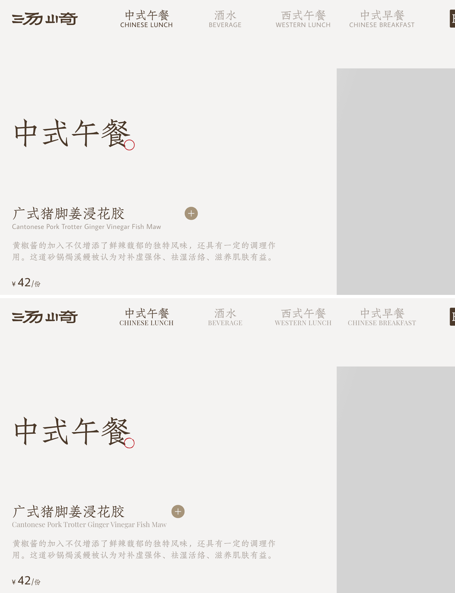

# 点餐系统 · 平板电子菜单（8.0.10）

店主 2026-11-11 把后续主线开发转到新的主线开发会话，并提了新需求：「目前我们的点餐系统，这个是显示在 yuzu 系统前台部分 UI 的」，附 UI 设计师发的两份设计稿（飞书云空间）：

- 《点餐系统版面模板-26.11.11.pdf》（文字可选，用来量字号、颜色、位置）
- 《点餐系统版面模板（转曲）-26.11.11.pdf》（文字转成了轮廓，用来看最终效果、取汤崎字标）

两份内容相同：1 张总览 + 22 张 1024×768 的屏。这是一套**放在餐桌上、给客人自己翻的平板电子菜单**：客人翻菜单、把菜加进「未下单」，叫服务员过来输密码确认，菜就挂到客人的手牌上、送进厨房。

这一版（8.0.10）照设计稿把它做进 yuzu：平板上的点餐页、后台的菜单编排、服务员的点单密码。迁移 `121`（`ROADMAP.md` 第 7 节登记）。没定的规则按默认做，记在 `PENDING_DECISIONS.md`「8.0.10」（DC1–DC18，待确认），能调的都在后台页面上改。

> 8.0.9（安保巡场，[PR #91](https://github.com/Venture-VV/yuzu/pull/91)）由原主线会话收尾，已经用了迁移 `111`、`112`，之后的修正还可能接着用 `113` 起的号。两个会话同时登记容易撞号，所以这一版直接跳到 `121`（`120` 是员工食堂的）；等 #91 合并后把 `main` 合进来再交店主。

## 1. 设计稿里的 22 屏与这一版的对应

| 设计稿 | 内容 | 这一版 |
| --- | --- | --- |
| 启始页 | 氛围大图铺满、汤崎字标、版权行 | 做。氛围大图在后台上传，没传时是设计稿的浅灰底 |
| 起始页——输入手牌号、桌号、人数 | 氛围图虚化；「输入信息」弹窗：手牌、桌号、人数、数字键盘、取消、开始点单 | 做（第 3.1 节） |
| 分类启始页 | 分类大标题 + 一道主推菜 + 特写图 + 大图 | 做，版面「分类封面」 |
| 部分菜不展示图 | 左边大图，右边竖排小标题（精品推荐 BEST SELLERS）+ 两列菜名 | 做，版面「大图 + 文字」 |
| 菜品详情 | 大图、关闭、上一道 / 下一道、菜名、英文名、介绍、价格、规格（大份 / 小份）、加号 | 做（第 3.3 节） |
| 单个菜——大图 | 横幅大图，下面菜名与介绍 | 做，版面「单菜 · 横幅」 |
| 单个菜——大图加特写（两种） | 竖幅大图 + 特写小图 + 菜名介绍，左右两种排法 | 做，版面「单菜 · 左图」「单菜 · 右图」 |
| 搜索页面 | 顶部搜索框、下拉结果（中文名 + 英文名），选中后跳到那道菜所在的页 | 做（第 3.4 节） |
| 订单信息——未下单 | 右侧抽屉「菜品信息」：未下单 / 已下单、加减份数、备注、下单（请呼叫服务员） | 做（第 3.5 节） |
| 订单信息——已下单 | 已下单的菜与金额、整单合计、关闭 | 做（第 3.5 节） |
| 两个菜（三种） | 两道菜的三种排法 | 做，版面「两菜 · 错落」「两菜 · 并排」「两菜 · 一大一小」 |
| 备注——忌口 | 多选：不加香菜、不加辣椒、少辣、不加洋葱、不加香葱、重辣；自定义备注；备注完成 | 做（第 3.6 节），选项后台可改 |
| 备注——起菜方式 | 单选：即起、慢起 | 做（第 3.6 节），选项后台可改 |
| 三个菜（两种） | 三道菜的两种排法 | 做，版面「三菜 · 等宽」「三菜 · 错落」 |
| 无图——文字陈列 | 竖排小标题（酒水 BEVERAGE）+ 两列、每列 5 行：名称、英文名、产地、年份、价格、加号 | 做，版面「文字陈列」 |
| 确认下单 | 「确认信息」弹窗：手牌、桌号、人数（读起始页填的）、密码、数字键盘、取消、下单 | 做（第 3.7 节） |
| 下单成功 | 弹窗 2 秒、对勾画出来 | 做 |
| 售罄状态 | 图片压暗 + 「已下架 Discontinued」「当前时段不可售 Not Available Now」「已售罄 Sold Out」 | 做（第 3.8 节） |

这一版做出来的各屏截图在 `docs/screenshots/emenu/`：`01`–`22` 按设计稿的页序（用设计稿里的样例菜单排的，价格是演示数据），`admin-*` 是后台的四处。

## 2. 这套东西怎么用

1. **后台准备一次**（店主、店总）：
   - 「后台 → 餐饮」里照旧建出品档口、把菜挂到档口上、开启餐饮功能（平板上只能点进厨房的菜）。
   - 「后台 → 电子菜单」：给菜配上英文名、介绍、图片与规格（「菜品图文」）；建分类（中式午餐、西式午餐、酒水……，可以设供应时段）；每个分类排若干页，每页选一种版面、把菜放进去（「版面」）；上传起始页的氛围大图、改忌口与起菜方式的选项（「设置」）；最后打开「平板点餐」开关。
   - 嫌一页页排太慢，可以先点「从价目表生成初稿」：把进厨房的菜按价目表的分类自动排成文字陈列页，之后再换版面、配图。
   - 「后台 → 员工账号」：新建一个岗位是「点餐平板」的账号，给每台平板登录用；给会点单的同事各生成一个 6 位「点单密码」（同事也可以自己在「修改密码」页生成）。
2. **平板**：用「点餐平板」账号登录，自动进点餐页（地址 `/emenu`），停在起始页。建议在 iPad 上「添加到主屏幕」全屏打开、开「引导式访问」锁住。
3. **客人**：点一下起始页 → 输手牌号、桌号、人数 → 开始点单 → 翻菜单、点加号 → 右上角订单图标里看「未下单」，可以加减、写备注 → 点「下单（请呼叫服务员）」。
4. **服务员**：过来核对手牌、桌号、人数，输自己的点单密码，点「下单」。菜记到这张手牌的账上（结账时一起结），同时送到厨房屏，厨房屏上写着送到哪张桌、整单的备注。经办人记的是这位服务员。
5. 下单以后客人在「已下单」里看这张手牌点过的菜与合计；想退菜、改单找服务员，在门店系统「餐饮 → 点单」里照旧处理（平板上不能退）。

## 3. 平板点餐页

整页按 1024×768 的设计稿等比缩放到屏幕（DC15）：4:3 的 iPad 正好铺满，别的比例上下或左右留边。页面不能选字、不能长按出菜单。

### 3.1 起始页与「输入信息」

- 起始页点任意位置出「输入信息」。背景的氛围图虚化、盖一层半透明（设计稿的批注）。
- 三项：手牌、桌号、人数，点哪一项哪一项接收键盘；「清空」清掉这一项。
- **手牌（DC4）**：键盘只有数字，所以只输数字部分就行——店里的手牌是「字母 + 4 位数字」或 4 位数字，数字部分不重复，输 `8060` 就是 `A8060`。在店客人里这串数字对得上两张牌时，让客人点选是哪一张。外接键盘、扫码枪、读卡器打进来的字母与数字也认。
- **桌号（DC5）**：后台「餐饮 → 桌台」里建了桌台的，只能填建过的桌（只输数字也行，重了让选）；一张桌台都没建时照输入的记。这台平板上一次下单用的桌号会记住、下次预先填好（平板一般固定在一张桌上）。 平板上只有数字键盘：桌台的名称里要带数字（`A08`、`8 号桌`），名称里没有数字的桌（如「大厅」）平板上输不了——后台「电子菜单」开头会列出这样的桌，请到「餐饮 → 桌台」改成带编号的名称。
- **人数（DC6）**：1–99，必填。只记在点餐单上（以后统计用），不影响价格。
- 「开始点单」时向门店系统核对：手牌要有在店客人、桌号要对得上，对不上在弹窗里红字提示。「取消」回到起始页。

### 3.2 菜单

- **顶栏**：汤崎字标；现在供应的分类（中文 + 英文，当前的那个深色）；搜索；订单（有没下单的菜时带数量角标）；右上角「手牌: A8060」（点它可以结束这次点餐、回到起始页）。
- **分类与供应时段（DC9）**：分类可以设时段（例如中式午餐 11:00–14:30），不设就是全天。默认只显示现在在时段里的分类与全天的分类；后台可以改成「不在时段的也显示、但不能点」。页面开着跨过了时段，那个分类的菜马上标「当前时段不可售」。
- **翻页**：每个分类是若干页，左右滑动翻页（键盘左右键也行），页面底部有一排小点表示第几页；滑到最后一页再滑进下一个分类。
- **版面**：11 种，尺寸、字号、颜色照设计稿量的（第 5 节）。图片位没配图时是设计稿那种浅灰底。
- **加菜**：点菜旁边的加号。只有一种规格的直接加进「未下单」；有大份 / 小份的打开菜品详情选规格。点图片或菜名打开菜品详情。
- 菜单每 15 秒向门店系统取一次：价格、沽清、上下架、后台改的版面都会跟上。

### 3.3 菜品详情

设计稿「菜品详情」：整屏大图，右上角关闭，左右箭头是这个分类里的上一道 / 下一道，下面一张卡片：菜名（带小字，如「煎档」）、英文名、介绍、价格、规格、加号。规格选中的那个深色。加号把选中的规格加进「未下单」。

### 3.4 搜索

点放大镜出搜索框（「搜一搜想吃的菜」），按中文名、英文名找，下拉列出结果；点一条跳到这道菜所在的页，并把它闪一下。只搜现在显示的分类里的菜。

### 3.5 订单抽屉（菜品信息）

- **未下单**：加进来的菜，每行加减份数（减到 0 就拿掉）；同一道菜同一规格合成一行，一行最多 99 份、一单最多 30 行（DC18，与门店系统的点单页相同）。下面是「备注」与「下单（请呼叫服务员）」。
- **已下单**：这张手牌这次来访全部有效的餐饮明细（服务员在点单页点的、小程序扫码点的也在，DC11），每行金额，下面「整单合计」只算餐饮。「关闭」收起抽屉。
- 没下单的菜只存在这台平板上，不占沽清；别的平板把最后一份点走了，这边 15 秒内变成「已售罄」，下单时门店系统再核对一次。

### 3.6 备注

- **整单备注（DC7）**：忌口（多选）、起菜方式（单选，可以不选）、自定义备注（最多 30 个字）。默认都不选。
- 下单时拼成一句（如「不加香菜，少辣，慢起，老人牙口不好」），写到这一单**每道菜**的口味备注上，厨房屏、点单页都看得到。
- 「起菜方式」这一版只是备注里的文字，不改厨房的出品流程（8.0.8 的 A06 还在等现场调研）。
- 选项在后台「电子菜单 → 设置」里改。

### 3.7 确认下单与点单密码

> 8.0.15 起点单密码是设置里的一项、**默认不要**（第 12.1 节）。下面写的是「要」的时候。

- 弹窗「确认信息」带出起始页填的手牌、桌号、人数（都还能改），第四项是密码——服务员输自己的 **6 位点单密码**，点「下单」。
- **点单密码（DC2）**：
  - 每位员工一个，6 位数字，**由系统生成**、当场显示一次（不让自己挑，免得撞上别人的时候等于告诉他别人的密码）。
  - 后台「员工账号」里店主给人生成、重置、收回；本人登录后在「修改密码」页也能自己重新生成。
  - 只用来在平板上确认下单与处理「结果待确认」，不能登录、不能做别的。
  - 输错：同一台平板（按它登录的账号记，不分来源地址）15 分钟内错 5 次，锁 5 分钟；单独一份计数，不影响店里别的设备登录；同一台平板一次只核对一个密码，同时发来一批也是错满 5 次就锁，锁着的时候对的、错的回的都一样。
  - 密码不存在平板上：断网后原样重提、确认作废都要再输一次。
- **谁能确认（DC3）**：与点单页下单同一套权限——「餐饮点单」+「前台挂账」。没有权限的密码输对了也拒绝，提示找有权限的同事。
- 下单走的是点单页同一条挂账路径：价格以门店系统为准（页面上的合计对不上就拒绝、提示重新确认）、只限某一性别的项目照核对、沽清不够整单拒绝。
- 另外核对：菜要在电子菜单上、所在的分类现在在供应时段里；手牌没换人。
- 成功后弹「下单成功」2 秒，「未下单」清空；提示完自动回起始页，手牌、桌号、人数、备注都清掉（店主 2026-11-14，见第 13 节；原来是留在这张手牌的菜单里）。

### 3.8 售罄、下架、时段不可售

| 状态 | 什么时候 | 平板上 |
| --- | --- | --- |
| 已售罄 Sold Out | 厨房「沽清」把今天的余量设成 0 | 图片压暗写「已售罄」，加号灰掉；没有图的版面在价格旁写「已售罄」 |
| 已下架 Discontinued | 价目表里停用了、不再挂在出品档口上，或「菜品图文」里停用了 | 同上，写「已下架」。版面是排好的，不会因为下架缺一块；换掉它请到后台改版面 |
| 当前时段不可售 Not Available Now | 所在分类不在供应时段 | 同上，写「当前时段不可售」 |

### 3.9 结果待确认（断网、超时、服务器出错）

与门店系统所有写操作同一套做法（AGENTS.md「开发约定」）：

- 点「下单」前，先把操作编号与原请求（不含密码）存在这台平板上并读回核对，存不了就不发请求。
- 超时、断网或服务器出错时不当作失败，弹「下单结果待确认」：
  - **查回结果**：只读，查到已经下单就按成功处理；查不到不能断定没生效。
  - **重新提交**：原编号、原内容再提交一次（要再输点单密码），门店系统保证只生效一次。被明确拒绝时先作废原编号再下结论。
  - **作废重填**：要输点单密码；门店系统登记作废后，原请求即使迟到也不会生效，这时才能改菜重下。
- 待确认没处理完时，这张手牌在这台平板上不能再下新的一单。

### 3.10 没人动回到起始页

默认 10 分钟没人碰屏幕（DC12，后台可改，0 为不自动回）：清掉没下单的菜、回到起始页，下一位客人从头开始。有「结果待确认」没处理时不清那一笔。平板待机时页面里的定时器是停的，所以屏幕一亮（页面重新可见、回到前台）马上核对一次，不等下一个 5 秒（第 13 节）。

### 3.11 设计稿之外补的（请设计师过目）

设计稿没画、但用起来缺不得的几处，先按设计稿的字体与颜色做了，设计师给了样式再换：

1. 菜单页底部的翻页小点。
2. 订单图标上的数量角标。
3. 点「手牌: A8060」出来的「结束点餐」确认。
4. 弹窗里的红字提示（手牌不对、密码不对、沽清了……）。
5. 「下单结果待确认」弹窗。
6. 手牌、桌号数字重了时的点选。
7. 没有图片的文字版面上的「已售罄」等小字。
8. 没有分类在供应时段时的一页说明（「现在不在供餐时段」+ 各分类的时段）。
9. 自定义备注的输入框。
10. 「输入信息」弹窗按钮下面的一行灰字提示（「手牌只输数字就行，例如 A8060 输 8060」）。
11. 「未下单」底部的一行小字（「这一单 ¥…，记在手牌上，离店时一起结」）。
12. 加菜以后页面底部一会儿就消失的提示条。
13. 不能点的菜（已售罄、已下架、不在时段）加号变浅——设计稿「售罄状态」那一屏的加号没变。

另有两处与设计稿略有出入：英文与数字换了字体（DC14），字形不完全一样；「大图 + 文字」版面的加号按列对齐（设计稿里每行是手摆的，位置略有出入）。

## 4. 后台

### 4.1 电子菜单（后台新分区）

权限「维护电子菜单」（默认店主、店总，DC16）。开头列出还差哪几步才能用（餐饮功能没开、没有菜品、没排版面、没有「点餐平板」账号、没人有点单密码、桌台名称里没有数字、开关没开）；下面三个分区，另有「从价目表生成初稿」：

- **分类与版面**：左边分类（新建、改名、英文名、供应时段、排序、停用），右边是选中的分类的各页，一页一张卡片——照平板样子画的预览（实时，不能点），旁边选版面、每个位置放哪道菜、竖排小标题（「精品推荐 BEST SELLERS」那种），可以上下挪、删页、加页。一个分类的各页整批保存、带版本号；同一页里同一道菜放两次、空页，页面上先说、不能保存；有没保存的改动时先保存或放弃再换分类。
- **菜品图文**：每道菜的展示名、英文名、名称后的小字、介绍、属性行（产地、年份……最多 3 行）、单位（份、位、瓶……）、大图、特写图、规格。
  - **规格（DC8）**：每个规格对应价目表里的一个项目——「砂锅焗溪鳗（大份）」「砂锅焗溪鳗（小份）」是两个项目，各有各的价格与沽清；电子菜单把它们并成一道菜、两个规格。只有一个规格的不用写规格名。价格不在这里填，读价目表。
  - 一个价目项目只能放进一道菜里。
- **设置**：平板点餐开关；起始页氛围大图；版权行文字；忌口、起菜方式的选项；多久没人动回到起始页；不在供应时段的分类显不显示。
- **从价目表生成初稿**（在「菜品图文」里）：还没进电子菜单的进厨房的菜，各建一道（展示名用项目名）；价目表的每个分类建一个电子菜单分类，按 10 道一页排成文字陈列。已经有的不动，可以重复点。

图片存在数据库里、随备份走（DC13），上传前在浏览器里压成 JPEG（最长边 1600 像素、不超过 1 MB），同一张图只存一份。

### 4.2 员工账号

- 新岗位 **「点餐平板」**（DC1）：只有「打开平板点餐」一项权限，登录后直接进点餐页，看不到门店系统别的页面。不能带库存与采购职责。
- 每位员工（「点餐平板」账号除外）有「点单密码」按钮：生成、重新生成（当场显示一次）、收回；有点单密码的标出来。

### 4.3 修改密码页

平板点餐开着时，有「餐饮点单」与「前台挂账」权限的员工多一块「点单密码」：看有没有、什么时候生成的，点「生成 / 重新生成」当场显示新的 6 位数（只显示这一次，旧的马上失效）。

## 5. 版面模板

11 种。括号里是每页放几道菜。坐标按 1024×768，从设计稿量的；顶栏高 102。

| 版面 | 设计稿 | 内容 |
| --- | --- | --- |
| 分类封面（1） | 分类启始页 | 分类大标题（48 号）、主推菜的文字、特写图 430×218、大图 429×594 |
| 大图 + 文字（≤ 6） | 部分菜不展示图 | 第一道菜的大图 429×594 在左；右边竖排小标题、两列菜名 |
| 单菜 · 横幅（1） | 单个菜——大图 | 大图 944×359；下面左菜名、右介绍 |
| 单菜 · 左图（1） | 单个菜——大图加特写 | 大图 429×594 在左，特写 171×203 在右上，文字在右 |
| 单菜 · 右图（1） | 单个菜——大图加特写 | 文字在左，特写在左下，大图在右 |
| 两菜 · 错落（2） | 两个菜 | 左：图 429×296 在上、文字在下；右：文字在上、图 343×390 在下 |
| 两菜 · 并排（2） | 两个菜 | 两张图 386×359、558×359 并排，文字在下 |
| 两菜 · 一大一小（2） | 两个菜 | 左：文字在上、图 558×359 在下；右：图 215×265 在上、文字在下 |
| 三菜 · 等宽（3） | 三个菜 | 三张图 257×344，文字在下 |
| 三菜 · 错落（3） | 三个菜 | 三张图 386×281、300×406、171×234，文字在下 |
| 文字陈列（≤ 10） | 无图——文字陈列 | 竖排小标题、两列各 5 行：名称、英文名、属性行、价格、加号 |

字体：中文朱雀仿宋（设计稿用的，开源，随应用打包）；英文与数字设计稿用的是 ABC Arizona Flare 的试用版（商业字体），没买授权前用开源的 Average Sans 顶上（字高、数字宽窄与设计稿的最接近，数字 0 与字母 O 分得清；字距照它调过，宽度与设计稿对得上），买了授权再换回原字体（DC14）。页面上文字的上下位置不靠字体自带的行高（朱雀仿宋的行高信息在苹果与安卓 / Windows 上取值不同）：字体列表最前面放了两个只规定行框尺寸的小字体（中文 0.707 / 0.293、英文 0.745 / 0.255，与设计稿 PDF 里的文字框一样），各平台排出来与设计稿量的位置一致，说明在 `src/client/features/emenu/emenu.css` 开头。

颜色：字 `#4B392A`，次要的字与线 `#A59C95`，按钮 `#A6947A`，页面底 `#F4F3F2`，弹窗 `#F7F8F8`、弹窗标题带 `#F8F7DB`，键盘键 `#F4F3F2`、功能键 `#DBDBDB`，图片位 `#D3D3D3`。

## 6. 数据（迁移 `121`，只增）

| 表 | 内容 |
| --- | --- |
| `emenu_images` | 图片（内容摘要去重，只追加） |
| `emenu_dishes` | 一道菜的图文：展示名、英文名、小字、介绍、属性行、单位、大图、特写图、启用、版本号 |
| `emenu_dish_specs` | 规格：哪道菜、价目表的哪个项目、规格名、顺序；一个项目只能在一道菜里 |
| `emenu_categories` | 分类：名称、英文名、供应时段（起止分钟，空为全天）、排序、启用、版本号 |
| `emenu_pages`、`emenu_page_dishes` | 分类的各页：版面、小标题；每页每个位置放哪道菜 |
| `emenu_orders` | 点餐单（只追加）：操作编号、来访、手牌、桌号、人数、备注、出品单号、合计、确认的服务员、哪台平板的账号 |
| `staff_order_pins` | 点单密码：员工、前三位（用来找人，不重复）、整个密码的 scrypt 摘要 |

另外：

- `staff.role` 加「点餐平板」（`tablet`）。
- `kitchen_items.note`（口味备注）从最多 40 字放宽到 100 字：整单备注（忌口 + 起菜方式 + 自定义）要放得下。点单页、小程序扫码点餐照旧 40 字。
- 设置存在 `settings` 的 `emenu_rules`。
- 钱只在账单明细里：平板下单就是 `postChargesTx`（与点单页、小程序扫码点餐同一条路径），操作编号记在 `idempotency_keys`（业务类型还是「挂账」`bill_post`，所以不用改操作编号、「确认作废」的两条约束）。出品单的「送到哪张桌」用 v0.7.28 就有的 `deliver_to`。

点单密码为什么这样存：6 位数字一共只有一百万种，不管怎么加密，库泄露了都能很快试出来，所以防护放在线上——要先用平板账号登录、输错限次、每次确认记审计。库里不存明文，存 scrypt 摘要；为了按密码找到人，另存前三位（系统生成时保证前三位不重复）。

## 7. 接口

平板（要登录，要「打开平板点餐」）：

| 接口 | 用途 |
| --- | --- |
| `GET /api/emenu/menu` | 设置、现在显示的分类与各页、每道菜每个规格的价格与状态、桌台 |
| `GET /api/emenu/guest?tag=` | 按输入的手牌找在店客人（数字重了回 409 与候选）；带回已下单的菜 |
| `GET /api/emenu/table?table=` | 核对输入的桌号：建了桌台的要对得上（只输数字也行，重了回 409 与候选），没建桌台的照输入的记；返回记下来的桌名 |
| `POST /api/emenu/orders` | 下单（带操作编号、点单密码） |
| `GET /api/emenu/orders/by-key/:key` | 结果待确认时查回 |
| `POST /api/emenu/orders/by-key/:key/abandon` | 确认作废（带点单密码） |
| `GET /api/emenu/images/:id` | 图片 |

后台（「维护电子菜单」）：`GET /api/admin/emenu`、`PUT /api/admin/emenu/rules`、`POST|PUT /api/admin/emenu/categories[/:id]`、`PUT /api/admin/emenu/categories/:id/pages`、`POST|PUT /api/admin/emenu/dishes[/:id]`、`POST /api/admin/emenu/images`、`POST /api/admin/emenu/draft`（从价目表生成初稿）。

点单密码：`POST /api/staff/:id/order-pin`、`POST /api/staff/:id/order-pin/clear`（管理员工账号）；`GET|POST /api/auth/order-pin`（本人，要「餐饮点单」）。

拒绝码：`EMENU_DISABLED`（开关没开）、`TAG_NOT_IN_STORE`、`TAG_AMBIGUOUS`、`TABLE_NOT_FOUND`、`TABLE_AMBIGUOUS`、`PIN_INVALID`、`PIN_LOCKED`、`PIN_NO_PERMISSION`、`DISH_NOT_ON_MENU`、`DISH_NOT_AVAILABLE_NOW`、`TAG_CHANGED`，以及挂账原有的 `DISH_SOLD_OUT`、`PRICE_CHANGED`、`ITEM_GENDER`、`VISIT_CLOSED`、`OP_ABANDONED`、`IDEMPOTENCY_CONFLICT`。

## 8. 加锁顺序与幂等（写进 AGENTS.md）

- **平板下单**：点单密码在事务外核对（只读员工与点单密码两行，不加锁）；事务里与点单页下单同一套——来访 → 账单 → 沽清 → 出品单，之后写点餐单一行；写操作编号前照旧与「确认作废」串行（`bill_post`）。读电子菜单的分类、版面、菜品不加锁。
- **确认作废**：先核对点单密码，再照前台的作废登记（操作编号的咨询锁）。
- **后台**：保存一个分类的各页只锁那个分类一行（带版本号，对不上拒绝 `EMENU_CHANGED`），页与位置整批换；菜品图文的修改只锁那道菜一行（带版本号），规格整批换，「一个项目只在一道菜里」靠唯一索引兜底；新建分类、新建菜品不带操作编号——分类名、规格的唯一索引兜底，重复提交会被拒绝而不是建出两份；设置走规则锁；图片按内容去重、不加锁；生成初稿先取电子菜单的咨询锁、全部串行。
- **点单密码**：生成、重置、收回只锁那位员工的点单密码一行；前三位的唯一索引兜底，撞了换一个再试。

## 9. 这一版不做

- 平板上退菜、改单、催单、结账（找服务员，在门店系统里做）。
- 客人自己下单不经服务员（设计稿就是「请呼叫服务员」）。
- 每道菜单独的备注、做法当成可选项（设计稿是整单备注；「可选：陈皮丝蒸，本地姜茸焗」是写在菜名下面的小字，客人口头说或写自定义备注）。
- 按人数收茶位费、套餐、称重时价。
- 多语言切换（设计稿是中英对照同屏）。——8.0.13 做了「中 / EN」一键切换，见第 11 节。
- 起菜方式改厨房流程（等 A06 的调研）。
- 平板离线点餐（没有网不能下单，只保留「结果待确认」）。
- 小程序扫码点餐的菜单共用这里的图文（小程序线评估后再排）。

## 10. 验收要点

1. 后台建两个分类（一个设供应时段、一个全天）、排上 11 种版面各一页、给几道菜配图与规格，打开开关。
2. 用「点餐平板」账号登录：直接进起始页；打开 `/frontdesk`、`/admin` 回到点餐页，调门店系统别的接口被拒（403）。
3. 输手牌只输数字能找到；数字对得上两张在店的牌时让选；没有在店客人的牌提示。
4. 逐屏对照设计稿（`docs/screenshots/emenu/` 里有每屏的截图）：位置、字号、颜色。
5. 加菜（单规格直接加、多规格进详情选）、搜索跳到那一页、未下单里加减、备注选两项加自定义。
6. 确认下单：密码错提示、错 5 次锁；没有点单权限的员工的密码被拒；对的密码下单成功——前台这张手牌的账单上多了这几道菜（经办人是这位服务员），厨房屏上有送到的桌号与整单备注，`check` 全部 ✓。
7. 沽清：厨房把一道菜设成剩 1，一台平板点走，另一台 15 秒内变「已售罄」；两台同时下单只有一台成功。
8. 时段：把分类的时段改成已经过了，平板 15 秒内标「当前时段不可售」，这时下单被拒。
9. 结果待确认：下单时断网 → 弹待确认；恢复后查回已生效 / 重新提交不重复 / 作废后原请求不再生效。
10. 10 分钟没人动（可以把设置改成 1 分钟验）回到起始页。
11. 功能开关关着时：`/emenu` 提示没有开启，其余页面与升级前一样；从 8.0.8 的库升级后 `check` 全部 ✓。

## 11. 8.0.13 电子菜单整改（店主 2026-11-13）

店主 2026-11-13 发来门店同事整理的《电子菜单整改需求汇总》，三件事：外宾看不懂全中文的菜单，要一个「中 / EN」一键切换；点搜索框弹出键盘时菜品图被压小；整套页面偏静态、切换生硬，要升级动效（进入放大、退出缩小、滑动有惯性与回弹、菜品与分类有轻微的光影与高亮，整体舒缓）。这一版照做，迁移 `123`（只加列）。没说到的规则按默认做，记在 `PENDING_DECISIONS.md`「8.0.13」（EN1–EN12，待确认）。

### 11.1 中 / EN 一键切换

- **按钮在哪**：起始页右上角、菜单顶栏搜索图标左边，各一个「中 | EN」小开关（当前的那一半是卡其色底）。点一下整套页面换成英文，再点换回中文。输入手牌的弹窗开着时也能点。
- **换的是什么**：
  - 菜品：英文名变成主名称，中文名缩成下面的一行小字（服务员还看得懂客人指的是哪道菜）；介绍、名称后的小字、属性行、单位（`/份` → `/portion`）、规格（大份 → Large）换成英文。
  - 分类页签、封面大标题、竖排小标题：英文为主。
  - 界面上的字：按钮、弹窗、提示条、订单抽屉、备注（忌口、起菜方式的选项）、搜索、售罄 / 下架 / 时段不可售。弹窗标题原来就是「中文 + 英文小字」，切到 EN 后对调。
  - 给客人看的出错提示（手牌不在店、桌号不对……）按拒绝码换成英文。
- **不换的**：
  - 给服务员看的几处仍是中文：确认下单时门店系统的拒绝原因、「结果待确认」「没有下成」的说明、退出登录。
  - 送进厨房的整单备注仍是中文（客人点的是英文的「No cilantro」，厨房屏上是「不加香菜」）；客人自己写的自定义备注原样送。
  - 账单上记的仍是价目项目的中文名。
- **英文从哪来**：后台录。没有录英文的地方显示中文，不留空白：
  - 菜品图文多了「英文介绍」「小字的英文」「属性行的英文」「单位的英文」「规格的英文」；英文名、分类英文名、竖排小标题的英文 8.0.10 就有。
  - 单位、规格、默认的忌口与起菜方式内置了常见的英文（份 portion、位 person、瓶 bottle、大份 Large、不加香菜 No cilantro……），不用一个个填；后台填了的以后台的为准。
  - 「设置」里给每个忌口、起菜方式的选项填英文。
  - **英文对照表**：「菜品图文」里可以把所有菜导出成一张 CSV（编号、中文、英文各列），在表格软件里填好英文再导入——一次补完几十上百道菜。导入只更新英文各列、只认填了的格子（空着的不动原来的），编号对不上的跳过并列出来。
  - 「菜品图文」里排进了菜单、但缺英文名或英文介绍的菜带「缺英文」标记，可以只看这些。
- **什么时候回到中文**：结束点餐、没人动回到起始页时回到中文；在起始页切到 EN 以后 1 分钟没人开始点，也回到中文。页面被系统刷新，这一次点餐的语言还在。
- **可以关**：后台「设置 → 中英切换」关掉以后按钮不显示，页面只有中文（与 8.0.12 一样）。
- 后台「分类与版面」的预览可以切「中文 / EN」看两种样子。

### 11.2 搜索时适配键盘

原因：部分安卓平板弹出键盘时会把网页可用的高度压小，而整页是按「屏幕高度」等比缩放的，于是整页（连同菜品图）一起缩小、两边留白。

- 键盘弹起时**不再重新计算缩放**：页面大小、菜品图的比例都不变。只有屏幕真的变了（旋转、换窗口大小）才重新算。
- 页面保持顶端对齐，键盘盖住下半屏；搜索框在最上面，结果列表的高度按键盘上面剩下的空间收，放不下的在列表里滑动。
- 输入的地方在屏幕下半部分时（备注抽屉的「自定义备注」），整页往上挪到输入框露出来为止，键盘收起后回到原位。
- iPad 上键盘本来就盖在页面上、不改页面大小，这次改动对它没有影响（同一套逻辑）。

### 11.3 动效

设计稿没有规定动效，这一版按「舒缓、轻、不打扰」来做，时间与曲线统一定义在 `emenu.css` 开头，以后要调改一处。

| 位置 | 做法 |
| --- | --- |
| 打开菜品详情 | 从被点的那道菜的位置轻微放大（0.94 → 1）、淡入；上一道 / 下一道时图片与文字交叉淡入 |
| 关闭菜品详情、弹窗、抽屉、搜索 | 不再瞬间消失：弹窗与详情缩小淡出，抽屉向右滑出，背景淡出 |
| 点分类页签 | 直接到那个分类的第一页（不再横向滚过中间的页），那一页轻微放大、缓入 |
| 开始点单、结束点餐 | 菜单、起始页缓入 |
| 左右翻页 | 改成跟手拖动：手指带着页面走，松手按速度与距离决定翻不翻，带惯性缓停；第一页、最后一页再拖有阻尼、松手回弹 |
| 抽屉与搜索结果里上下滑 | 滑到头再拖有阻尼、松手回弹 |
| 菜品图、菜名 | 按下（鼠标是悬停）时微微浮起、带一层柔和的阴影，图片上扫过一道淡淡的光 |
| 加号 | 按下回弹；加菜时一个小圆点从加号飞到右上角的订单图标 |
| 分类页签 | 选中的那个下面有一块柔和的渐变光晕与一条渐隐的细线，换分类时滑过去 |
| 起始页 | 氛围大图极慢地放大缩小（24 秒一个来回） |
| 图片 | 加载完淡入，不再一下子跳出来 |
| 提示条 | 淡入、停留、淡出 |

- 系统设置了「减少动态效果」的设备上全部关掉；后台「设置 → 动效」也可以改成「简洁」（老平板卡的时候用）。
- 动效只用位移、缩放与透明度，不改版面：中文模式下各元素静止时的位置仍是设计稿量的位置。

这一版设计稿之外补的（请设计师过目）：顶栏与起始页的「中 | EN」开关（有它时分类页签最多排到 705，超过 3 个分类会比原来挤一点）；英文模式下各处的字号与排法（英文菜名 14 号、放不下折两行，中文名 9 号小字；弹窗与抽屉的标题英文在上、中文在下）；上表的全部动效。截图：`docs/screenshots/emenu/en-1-list.png`、`en-2-detail.png`、`en-3-remark.png`、`en-4-search-keyboard.png`（把窗口压矮模拟键盘）、`admin-5-dish-english.png`、`admin-6-settings-english.png`。

### 11.4 数据与接口

- 迁移 `123`：`emenu_dishes` 加 `tagline_en`、`description_en`、`attrs_en`、`unit_en`，`emenu_dish_specs` 加 `label_en`（都有默认值，旧数据不动）。
- 设置（`settings.emenu_rules`）加三项：`langSwitch`（中英切换，默认开）、`optionsEn`（忌口与起菜方式选项的英文）、`motion`（动效，默认丰富）。
- `GET /api/emenu/menu` 的菜品、规格、设置带上上面这些；下单接口不变（忌口、起菜方式交的仍是中文选项）。
- 后台新增 `GET /api/admin/emenu/english.csv`（导出英文对照表）、`POST /api/admin/emenu/english`（导入）。导入在一个事务里按菜品编号升序锁菜品一行、只改有变化的、版本号加一，记一条审计；同样的内容再导一次什么都不改。
- 对照表里以 `=`、`+`、`@`、`-` 开头的格子，导出时前面带一个单引号（免得表格软件当成公式执行）；本来就以「单引号 + 这些字符」开头的多带一个。导入时对照这一格**现在的值**来读：
  - 与现在的值导出来的样子一模一样：没改过，不导入（导出的文件不改直接导入，一个字都不会变）；
  - 改过，而且这一格导出时带着防公式的单引号：开头的单引号当作系统加的那一个，去掉；这样去掉的格子在导入前的预览里列出来（第几行、哪一列、会保存成什么，8.0.17）——填的人想把单引号留作内容时文件里分不出来，所以不悄悄改，要留的打开那道菜直接改；
  - 改过，这一格导出时不带（空格子、普通的字）：系统没加过，开头的单引号是填的人自己写的，照字面保存（在空格子里填 `'+1 Combo` 存下来就是 `'+1 Combo`）。
  - 在表格软件里想填以 `+`、`=` 开头的英文，照表格软件的习惯在前面打一个单引号（它存出来的文件里没有这个单引号），或者直接在文本编辑器里写。
  - 已知的限度：导出以后、导入之前，别人把同一格从「带防公式单引号的值」改成了普通的字，这时旧文件里那一格开头的单引号会被当成内容存下来（这种情形旧文件本来也会盖掉别人的改动）。导入窗口读文件之前会取一次最新的菜品，所以只在这两步之间有人改才会遇到。

### 11.5 这一版不做

- 自动翻译（不把菜单发给外部的翻译服务）；英文由店里录，或导出对照表交给翻译的人。
- 中英以外的语言。
- 小票、厨房屏、账单的英文。
- 按语言分别统计点餐。

### 11.6 验收要点

1. 后台给两道菜填英文介绍、一道不填；设置里给忌口选项填英文。平板点「EN」：填了的显示英文、中文名在下面小字；没填的仍显示中文；再点回到中文，位置与 8.0.12 一样。
2. EN 下加菜、备注选「No cilantro」、下单：厨房屏上的备注是「不加香菜」。
3. 导出英文对照表 → 填几格 → 导入：只改填了的；再导一次提示没有变化。
4. 安卓平板（或把浏览器窗口的高度拖小模拟键盘）点搜索：页面不缩小，结果列表在键盘上面。
5. 逐项看 11.3 的动效；系统开「减少动态效果」或后台改「简洁」后全部没有。
6. 结束点餐后回到中文。

## 12. 8.0.15 平板放大与点单密码开关（店主 2026-11-13）

店主在平板上看了以后说：「字实在太小了，还有模块，请你都放大，要考虑人性化。以及点单密码这个功能做成可配置吧，默认关闭就可以。」默认规则 EM1–EM4 在 `PENDING_DECISIONS.md`「8.0.15」。没有迁移（两项都存在 `settings.emenu_rules` 里）。

### 12.1 点单密码：做成可配置，默认不要

后台「电子菜单 → 设置」多一行「点单密码」：

| | 不要（默认） | 要（8.0.14 及以前的做法） |
| --- | --- | --- |
| 订单抽屉的按钮 | 「下单」 | 「下单（请呼叫服务员）」 |
| 确认信息 | 手牌、桌号、人数三项（带出来的，还能改），点「下单」 | 多一项密码，服务员输 6 位点单密码 |
| 这一单的经办人 | 这台平板登录的账号（账单明细的挂账人、点餐单、审计都记它；审计里另有一个标记说明没用密码） | 输密码的那位服务员 |
| 结果待确认 | 查回、重新提交、作废重填三个按钮直接能点，弹窗里没有数字键盘 | 重新提交、作废重填要再输密码 |
| 员工的点单密码 | 留着不用；后台不再提醒「还没有员工有点单密码」 | 照旧 |

- 别的规矩都没变：手牌要在店、桌号要对得上、菜要在电子菜单上且在供应时段、价格以门店系统为准、沽清不够整单拒绝、同一个操作编号只生效一次。
- 请求里带了密码而后台是「不要」：不看、不记输错。后台是「要」而请求里没有密码：拒绝（`请输入 6 位点单密码`）。平板 15 秒内跟上后台的改动；正好卡在改动那一刻的一单会被拒绝一次，平板随后取到新的设置。
- **要知道的一点（EM4）**：不要密码时，拿到平板、知道一张在店手牌的号码与桌号的人就能往这张手牌上点菜。每一单都记着是哪台平板、什么时候下的，点错的照旧在前台退菜。平板请交给服务员或放在看得到的地方；不放心就改成「要」。
- **升级（EM2）**：设置里没存过这一项的店（包括已经在用点单密码的）升级后都是「不要」。想继续要密码，升级后到设置里改成「要」。

### 12.2 字与按钮放大

设计稿按 1024×768 画，菜名 16 号、介绍 9 号、英文名 8 号；10 寸的平板上介绍的字高不到 2 毫米。后台「电子菜单 → 设置」多一行「字与按钮的大小」：**放大**（默认）与**设计稿原样**（与 8.0.14 一模一样）。

放大的一档：图片的位置与大小不动；文字、按钮按下面的倍数放大，文字块的位置重新排，原来留得很宽的行距收紧一些。

| 哪里 | 倍数 | 放大以后（1024×768 的屏上） |
| --- | --- | --- |
| 菜单页上一道菜的文字 | 1.4 | 菜名 22、英文名 11、介绍 13（行距 19）、价格 20；加号 21（点按区域 60 以上） |
| 文字陈列的一行、竖排小标题 | 1.35 | 菜名 22、属性行 12、价格 19；5 行的间隔从 90 拉到 112，两列往左挪 |
| 顶栏 | 1.3 | 分类名 18（分类多、名字长时按最宽的名字收一点，不小于原来的 14）；中｜EN、搜索、订单、手牌色块 1.3 倍，手牌色块右边仍贴着页边 |
| 菜品详情 | 1.3 | 下面的卡片高 153 → 200，菜名 23、介绍 16、价格 31，加入按钮 92 × 35；关闭、上一道、下一道的圆按钮 30 → 42 |
| 搜索 | 1.3 | 搜索框宽 689 → 896、高 44，字 21；每条结果高 44 |
| 订单、备注抽屉 | 1.25 | 抽屉宽 426 → 532；菜名 18、加减的圆点 22、按钮高 35 |
| 弹窗（输入信息、确认信息、下单成功、结束点餐等） | 1.3 | 429 × 501 → 558 × 651，数字键 77 见方 |
| 提示条、翻页小点、起始页的版权行 | — | 提示条的字 12 → 16；小点 1.5 倍；版权行 1.2 倍 |

各版面文字怎么挪的：

- **分类封面、两菜（交错）的第二道、两菜（一大一小）的第一道**：文字的下面紧挨着图，改成下沿贴在图上面 24、往上长（介绍多几行也不会压到图）。
- **图文列表**：小标题与两列往左挪（图右边到页边的空都用上），三行拉开；菜名 7 个字以内一行放下。
- **文字陈列**：小标题与两列往左挪到原来空着的左边，行距拉开。
- 其余版面：文字块的起点略往上提，宽度用到图的宽度。
- 后台的版面预览跟着这一项：平板上放大，预览也放大。

做法（`src/client/features/emenu/stage.tsx` 的 `BIG`、`useBig`、`ZoomAt`）：各处里面仍照设计稿的像素写，外面套一层按倍数放大。「设计稿原样」时这些层不起作用，所以设计稿的位置核对（浏览器用例「各尺寸」）照旧在这一档上做。

**请设计师过目**：放大的倍数与各版面文字的新位置是开发按「看得清、好点」定的，不是设计稿；要调的地方请直接说哪一屏、哪一块。

### 12.3 这一版不做

- 客人自己调字号（平板上没有这个入口；后台一处设置管所有平板）。
- 每台平板各设各的。
- 放大图片或改版面的图片位置。

### 12.4 验收要点

1. 升级后不改设置：平板上字与按钮是放大的；点菜 → 订单 →「下单」→ 确认信息里没有密码 → 点「下单」成功；前台这张手牌的账单上有这几道，挂账人是平板的账号。
2. 设置里「点单密码」改成「要」：15 秒内平板上的按钮变成「下单（请呼叫服务员）」，确认信息多出密码一项，与 8.0.14 一样。
3. 设置里「字与按钮的大小」改成「设计稿原样」：平板与 8.0.14 一模一样。
4. 放大的一档逐屏看：11 种版面（中文、EN 各一遍）文字不压图、不出页边；菜品详情、搜索（键盘弹起时结果在键盘上面）、订单与备注抽屉、各个弹窗都在屏幕里。
5. 断网下一单（不要密码时）：「结果待确认」里三个按钮直接能点，没有数字键盘；作废后可以改菜重下。

## 13. 下单完成后回起始页（店主 2026-11-14《8.0.19 需求与问题》第 7 条）

门店反映：选了手牌点完单，页面停在这张手牌的菜单里，下一位客人没法直接开始，要服务员先点手牌「结束点餐」。

| 什么时候 | 原来 | 现在 |
| --- | --- | --- |
| 下单成功（要不要点单密码都一样；「结果待确认」里查回、重新提交成功也一样） | 提示 2 秒后留在菜单里 | 提示 2 秒（点一下马上关）后回起始页：手牌、桌号、人数、备注、没下单的菜都清掉，语言回到中文；这一次点餐不再存在平板上 |
| 服务员作废那一单，门店系统确认已作废 | 回到「未下单」，菜还在 | 回起始页，提示「原来那一单已作废，没有下成」；没下单的菜清掉（YX8，待确认） |
| 下单没成：断网、超时、服务器出错、密码不对、被门店系统拒绝、重新提交被拒绝 | 留在原页，菜还在 | 不变 |
| 加菜、改数量、翻菜单、看已下单 | 不跳 | 不变 |
| 待机后唤醒 | 靠 5 秒一次的定时器核对，屏幕亮起后可能先看到上一位的菜单几秒 | 屏幕一亮马上核对：过了设置的分钟数直接是起始页 |

- 同一位客人要接着点、看已下单：重新点「开始点单」输手牌（桌号记着上一次的）。这是固定行为，没有做成开关（YX7，待确认）。
- 提示的 2 秒里这一次点餐已经算结束：这时页面被系统刷新，打开也是起始页。
- 平板点餐没有结账：需求里写的「结账 / 挂单完成」对应的就是下单成功（下单 = 挂到手牌的账上）。
- 用例：`e2e/emenu.spec.ts`——真实流程里下单成功后回起始页、重新输手牌才看得到已下单；合成接口的两条核对成功、作废后回起始页，没有答复时留在原页；另加一条待机唤醒（用可控的时钟）。

## 14. 8.1.5 品牌调整：早中晚时段、字体、加号间距、切换图标、字标比例（店主 2026-11-16）

店主转来品牌方的《平板电子菜单、工作台页面UI及功能调整》，附两款字体文件（TTF）与中英切换的两张图标（PNG，深棕方块上浅色的「En」「中」，颜色正好是电子菜单的主文字色 `#4b392a` 与底色 `#f4f3f2`）：

1. 时段菜单：菜单按早、中、晚三个时段区分展示；对应时段仅开放该时段菜品（例如早时段只展示早餐菜单），自动切换。
2. 字体替换：菜单内中文、英文字体统一替换为需求文件内指定的两款字体。
3. 加号间距：带菜品图片的点菜加号与菜名间距倍率 4.5；纯文字菜品 2.5。
4. 切换图标替换：中英文语言切换图标替换为附件内提供的标识图。
5. Logo 尺寸比例：左上角汤崎标识尺寸 = 右上角操作图标尺寸的 0.7 倍；两个图标上下边角相互交叠。

平板、UI 工作台（画布与预览用的是平板同一套部件）、后台的版面预览一起改。迁移 `180`（`ROADMAP.md` 第 7 节登记）。需求里没写细的按默认做，记在 `PENDING_DECISIONS.md`「8.1.5」（PP1–PP8，待确认）。

### 14.1 早、中、晚三个时段

- **设置**（后台「电子菜单 → 设置 → 早中晚时段」）：三段的开始时间与名称（中文、英文）。三段首尾相接、盖满一天——早餐 06:00 起、午餐 11:00 起、晚餐 17:00 起（到第二天 06:00），一段的结束就是下一段的开始，任何时刻都正好在一段里（PP1）。
- **分类**（后台「电子菜单 → 分类与版面」编辑分类）：「在哪几段供应」多选早 / 中 / 晚，都不选是全天（饮品、酒水这类每段都有的）。**升级以后原来的分类都是全天，平板上什么都不变**；店主把早餐、午餐、晚餐的分类各自勾上才开始分段。
- 原来分类上的「指定时段」（8.0.10，DC9）留着，改叫「另外限定时间」：与时段同时满足才供应，比如晚餐里的宵夜 22:00–02:00。
- **平板**：只显示现在这一段的分类（加上全天的）；别的段的分类照 DC9 那个设置——默认不显示（「早时段只展示早餐菜单」），设成「显示但不能点」时灰着、标「当前时段不可售」（PP2）。
- **自动切换**（PP3）：
  - 门店系统在菜单里告诉平板下一次切换的时刻（时段交界、分类另外限定时间的起止），平板到点马上重新取菜单，不等 15 秒一次的刷新；
  - 停在菜单里的：换成新一段的菜单（原来那个分类还在就留在原页，不在了翻到第一页），弹一句「已到午餐时段，菜单已换成午餐」（英文时 "Now serving Lunch"）；
  - 「未下单」里上一段的菜照旧显示菜名，标「当前时段不可售」，要去掉才能下单；
  - 没有宽限：下单时门店系统按下单那一刻的时段再核对一次（与 DC9 一样，`DISH_NOT_AVAILABLE_NOW`）。
- 一道菜可以排在几个分类里：只要有一个排着它的分类现在供应，就能点。
- **UI 工作台**：平板菜单的工具栏多一个「时段」——现在 / 早餐 / 午餐 / 晚餐 / 全部，设计师看每一段的菜单长什么样；只影响画布上看到的，不改平板（PP8）。按某一段看时，分类另外限定的时间不算；「全部」是所有分类都显示。

### 14.2 字体

- **中文**：朱雀仿宋，8.0.10 起就是它（随应用打包的是 v0.212，这次给的文件是 v0.211，同一款字体），不用换。
- **英文**：ABC Arizona Flare。这次给的文件是**试用版**（字体文件里写着 "Unlicensed Trial"；Dinamo 的试用条款不许放在服务器上、不许随软件发出去，也只有 498 个字形），所以没有放进代码库、也没有部署，英文照旧用开源的 Average Sans 顶替（DC14）。
- 为了买了授权以后不用再改代码（PP4），授权的网页字体文件**不进 Git**（代码库是公开的），放在门店服务器上：
  - 文件：Dinamo 网页授权给的 WOFF2（Regular 那一款）改名成 `en.woff2`，放到服务器的 `brand-fonts/` 目录（Docker 部署是 `compose.yaml` 旁边的 `./brand-fonts`，挂进容器只读；不用 Docker 时是应用工作目录下的 `brand-fonts/`，`BRAND_FONT_PATH` 可以改）。仓库的 `.gitignore`、`.dockerignore` 都排除了这个目录。
  - 应用只把这个文件发给能打开平板菜单的账号（`GET /api/emenu/fonts/en.woff2`，与菜单同样的权限；没放文件 404）。
  - 平板、工作台、后台的版面预览打开时试着取一次：取到了英文就换成它，顶替字体补的字距（`.em-en` 的 0.027em）去掉；取不到照旧用 Average Sans。
  - 放上文件以后平板刷新一下页面就生效，不用重启、不用升级。换上以后照设计稿把英文的宽窄核对一遍：各处全大写小标题另补的字距是照 Average Sans 调的，可能要再微调。
  - **店主 2026-11-17：已有网页授权**（PP4）。用授权包里的网页字体文件（WOFF2），不用之前给的试用版 TTF。
- **统一**：电子菜单里所有的字（弹窗、数字键盘、抽屉、提示都在内）都是这两款字体——中文朱雀仿宋，英文与数字用英文字体；这一版逐处核对过。工作台主题里另外几种系统字体的选项留着（设计师自己选时才用），默认的仍是品牌字体。

### 14.3 加号与菜名的间距

> 8.1.14 起倍数改成 3.5 / 2（品牌部第三批，第 17.2 节）；下面是 8.1.5 当时的数，算法没变。

「倍率」按加号自己的大小算（PP5）：设计稿原来的间距 44.2 正好是加号（12.6）的 3.5 倍。

| 菜 | 版式 | 间距 | 原样（加号 12.6） | 放大一档（加号 15） |
| --- | --- | --- | --- | --- |
| 带菜品图片的 | 封面、单菜、两菜、三菜（每道菜有自己的图） | 加号的 4.5 倍 | 56.7（原来 44.2） | 67.5（原来 15） |
| 纯文字的 | 文字陈列的十行、图文列表右边的六格（这六格没有自己的图） | 加号的 2.5 倍 | 31.5 | 37.5 |

- 加号都紧跟在菜名（连同名称后面的小字）后面，竖直方向与原来一样比菜名高 0.9；图文列表六格原来按列对齐的加号、文字陈列原来在价格下面的加号，都改成跟在菜名后面。菜名太长时：中文换行、英文最多两行，加号跟在第一行后面。
- 放大一档的数字是放大以前的；平板上看到的再乘 1.4（图文）/ 1.35（文字陈列），比例不变。
- 文字陈列这一行：价格还在右上；名字放不下时比原来早一点点出省略号（要给加号与间距让出位置）。
- 共用的数在 `@shared/studio` 的 `EMENU_PLUS_GAP`（`photo` 4.5、`text` 2.5），卡片模板里每块文字记着自己是哪一种（`plus`）。

### 14.4 中英切换图标

- 用品牌给的两张图（PP6）：中文时显示「En」（点了换英文），英文时显示「中」（点了换回中文）——显示的是要切去的那种语言，外宾一眼找得到「En」。换的时候两张图淡入淡出（动效关着时直接换）。
- 大小：22.3 见方（与手牌色块一样高），放大一档 × 1.3。顶栏里右边仍在 774（原来「中 | EN」的右边），起始页仍贴在 984。图标边上照旧多留 11 的可点范围。
- 工作台里起始页的「中 | EN」块不变（48 × 22.3 的框，图标靠右放在框里，已经发布过的版面照常用）；「深浅」选浅色（起始页有大图时的「自动」）时图标外加一圈很淡的浅色描边，压在照片上更清楚。
- 图片在 `src/client/features/emenu/assets/`（品牌给的原图，191 × 191，四倍图）。

### 14.5 左上角字标

- 横排字标的高 = 右上角切换图标的高 × 0.7（PP7）：原样 15.6（原来 15.4，几乎不变）；放大一档 20.3（原来没跟着放大、只有 15.4，所以看着小）。宽按字标的比例跟着变（原样 80.7、放大一档 104.9），左边仍贴在 40。
- 「上下边角相互交叠」：字标与右边几样（切换图标、搜索、订单、手牌）上下居中在同一条线上（顶栏的 55.45），字标的上下沿落在切换图标的上下沿之间。

### 14.6 数据与接口

- 迁移 `180`：`emenu_categories` 加 `periods`（`text[]`，`breakfast` / `lunch` / `dinner` 的组合，空 = 全天；约束只认这三个）。
- 设置 `emenu_rules` 多一项 `periods`（三段的开始时间与名称）；没存过的用默认。保存时核对三段的开始时间是早 < 午 < 晚。
- `GET /api/emenu/menu`：分类多 `periods`；多 `period`（现在这一段：键、名称、起止）与 `nextChangeAt`（下一次可能切换的时刻）；`later` 每一类多 `periods` 与这一类里的菜（`dishes`：菜名、小字、各规格的名称、价格与状态；平板据此把「未下单」里的菜照旧显示菜名、标「当前时段不可售」，而不是「已不在菜单上」——页面刷新以后也一样，Codex 预检 `0f7c701` 的 P2）。
- `GET /api/studio/emenu/menu?period=breakfast|lunch|dinner|all`：工作台按某一段看（不带是现在）。
- `GET /api/emenu/fonts/en.woff2`：授权的英文字体（权限与菜单相同；没放文件 404）。
- 加锁不变：读设置、分类都不加锁；下单的核对在原来的事务里多读一列。

### 14.7 这一版不做

- 不同的日子用不同的时段（周末早午餐这类）、节假日菜单：时段只按一天里的时刻。
- 时段交界的宽限：交界前加进「未下单」的菜，过了点一律不能下（与 DC9 一样）。
- 起始页显示现在是哪一段（设计稿没画）：要的话请设计师给样式，加成工作台里的一块。

### 14.8 验收要点

1. 后台设置三段时间，给分类勾上早 / 中 / 晚：平板只显示现在这一段的分类与全天的；工作台「时段」切到每一段，画布上是对应的菜单。
2. 跨过交界（把下一段的开始时间设成一两分钟以后）：平板到点自动换菜单、弹提示；「未下单」里上一段的菜标「当前时段不可售」，去掉才能下单；直接用接口下上一段的菜被拒（`DISH_NOT_AVAILABLE_NOW`）。
3. 字体：没放授权文件时英文是 Average Sans；在独立演示库的服务器 `brand-fonts/` 放一个别的 WOFF2（开源字体就行）改名 `en.woff2`，刷新后英文换成它，删掉后换回。
4. 加号：有图的版式加号离菜名 4.5 个加号宽，文字陈列与图文列表六格 2.5 个；中文、EN、原样、放大四种都看。
5. 切换图标：中文时是「En」、英文时是「中」，点了切换；顶栏、起始页的位置；工作台里起始页那一块。
6. 字标：放大一档时字标的高是切换图标的 0.7、中线对齐；原样几乎不变。

## 15. 8.1.6 二次整改：页面稳定、中英文、可编辑的顶栏（店主 2026-11-17）

店主转来《二次需求：平板电子菜单、工作台页面UI功能整改》，要求「细致化地进行，改完在平板上演示，针对小米平板 6S Pro 12.4」。原文三条：

1. 页面稳定性优化：解决画面卡顿、页面错位问题；点开菜品大图时，禁止图层错叠、元素重叠。
2. 多语言功能修复：优化中英文切换流畅度，补齐英文版本内容，修复当前仅有中文、英文缺失的问题；补全右上角功能栏全部功能。
3. 顶层操作栏编辑器改造：顶层操作功能栏改为可编辑的设计界面；支持单独调整每个图标间距，图标拖动过程中实时显示间距数值。

原文没写细的读法与默认做法见 `docs/PENDING_DECISIONS.md`「8.1.6」QZ1–QZ10。没有迁移：顶栏的位置存在工作台版面的 `templates.header` 里（与 8.1.2 的卡片模板同一处）。

### 15.1 在小米平板 6S Pro 12.4 上看到的（QZ1）

屏幕 3048 × 2032，3:2；按 HyperOS 默认的显示大小，网页看到的是 1355 × 903（2.25 倍）。设计稿是 1024 × 768（4:3），整页等比缩放到 1.176 倍、左右各空出约 75（屏幕像素）。在这个大小上逐屏看、量：

- **错位**：弹窗、抽屉、搜索的压暗层，起始页的底，菜品大图，都只盖住中间 4:3 那一块，左右两条亮着；点左右两条什么反应都没有（搜索开着时点那里关不掉）。
- **图层叠错**：工作台里在菜单页加的装饰（字标、文字、图片）画在菜品大图上面——大图开在「顶栏」那一块里，装饰排在顶栏后面。
- **卡顿**：CPU 降速 4 倍量的（这台虚拟机，真机快几倍）：点分类、点开大图、开订单抽屉、切语言各有一次 60–105 毫秒的长任务，都是整组菜单页（当前页前后各两页）重画；点分类时那一页整个重建；第一次切到英文才下载英文字体；144 Hz 的屏上这些都在动画开头掉帧。
- **英文**：系统自己的字只剩服务员那一步（确认下单的拒绝原因、「结果待确认」、退出登录）是中文（8.0.13 特意留的），读屏说明是中文；门店没录英文的菜名、选项显示中文。
- 平板上的数以真机为准：「网络与同步」页（地址 `/network`）多一行「本机屏幕」，写着网页的宽 × 高、像素倍数、约多少实际像素，以及平板点餐页在这块屏上按几倍显示、两边各多出多少。

### 15.2 页面铺满屏幕（QZ2）

- 舞台（`stage.tsx`）照旧把 1024 × 768 的设计稿等比缩放、居中，同时算出屏幕比设计稿多出来的那一圈（「出血」，换算成设计稿的像素：`bleed.x`、`bleed.y`），舞台本身铺满屏幕、只在屏幕边上裁。里面的东西照旧按设计稿的坐标写，位置一点不变。
- 铺到屏幕边的：每一屏的底色（起始页的图片占位色、氛围大图与压暗）、弹窗与抽屉与搜索的压暗层、菜品大图（照片往左右、往下铺满，裁切按新的大小重新居中）、订单与备注抽屉的底（往右铺到屏幕边，里面的内容照旧）、下单成功的整屏。
- 不铺的：菜单页（左右翻时两边不露出相邻的页）、顶栏里的东西、弹窗本身。
- 4:3 的平板（iPad）没有出血，与 8.1.5 一模一样。

### 15.3 菜品大图单独一层（QZ3）

- 大图从「顶栏」那一块里拿出来，画在整个菜单页的最上面（在设计师加的装饰、翻页圆点之上），只让出顶栏那一条：顶栏里的中英切换、搜索、订单、手牌照常能点；搜索、抽屉、弹窗照旧在大图上面。
- 大图开着时下面的菜单页不接点按、不跟着翻。
- 卡片里英文菜名很长时在价格前面截断，不压到价格和加号上。

### 15.4 不卡（QZ4）

- 每一页菜单页只在它自己的内容（菜、语言、版面、闪一下的那道菜）变了时才重画：开大图、开抽屉、加菜、弹提示都不再重画整组页。
- 点分类跳到那一页：那一页照旧轻微放大缓入，但不再整个重建（图片不重新出现）。
- 开机就把中、英文字体（朱雀仿宋、Average Sans 或授权的品牌英文字体、两个行框字体）备好，第一次切英文不再等下载。
- 分类下面的光晕滑过去改成只动位移与缩放（原来动的是左边距和宽，每一帧都要重新排版）。
- 工作台：拖动、拉大小时每一帧最多改一次版面（144 Hz 的屏上手指一秒报一两百次）；拖动时不重新量每一块的框，松手再量。

### 15.5 中英切换顺滑（QZ5）

- 浏览器支持页面转场（View Transitions，安卓上的 Chrome 111 起）时，切换先留住旧画面、新的排好以后整屏交叉淡入（0.25 秒）；不支持或动效关着时直接换。
- 浏览器（`html` 根节点在切换的那一下临时带 `data-em-lang`）只给平板菜单切语言的这一次转场设时长，别的页面不受影响。
- 顶栏分类：按每个名字实际的字宽排（用页面上的字体在画布上量，字体下载完再量一次；不再按字数估）。放得下时与原来一样；分类多、英文名长放不下时整排一起缩小一点，最多缩到八成，还放不下的末尾显示「…」，不挤到旁边、不裁掉两头。后台填分类英文名的地方提示大约放得下 16 个字母。

### 15.6 英文补齐（QZ6）

- 服务员那一步改成双语：确认下单时门店系统的拒绝按拒绝码给英文（菜卖完了、时段不对、桌号不对、点单密码不对、价格刚改过……，`i18n.tsx` 的 `ERRORS_EN`），英文在上、门店系统原来的中文小一号在下一行；没有对应英文的拒绝码英文写「Refused by the store system」、下面照旧是门店系统的中文。「结果待确认」的说明与按钮、「没有下成」、退出登录同样。提示两种语言都存着，切语言时跟着换。
- 这几个弹窗切到英文时长高一点（上下各长一半、仍在屏幕正中）放下两种语言，不缩小字、不压到按钮；中文时与设计稿一样。
- 菜单还没取到（「正在打开菜单…」「连不上门店系统」）、平板点餐没开时，中文下面补一行英文；没有排菜单时的提示、工作台预览不能下单的提示跟着语言。
- 读屏说明（翻页圆点、数字键、各栏、弹窗的标题、字标）跟着语言换。
- 后台「电子菜单」：原来只数菜名、介绍缺英文的菜；现在顶上写「英文还缺 N 处」，列出分类名、页标题、菜名、介绍、忌口与起菜方式、时段名里缺的，点一处跳到那里补；英文对照表照旧。

### 15.7 右上角功能栏（QZ7）

- 中英切换、搜索、订单、手牌四样：菜品大图开着时照常能点（15.3），输入信息的弹窗开着时能切语言（原来就有），中文、英文下都能用（搜索认中文、英文菜名，订单抽屉、结束点餐都有英文）。
- 工作台里四样都能单独挪、改大小（15.8），不能删、不能藏（后台关了中英切换时中英切换那一块画成虚线框）。

### 15.8 工作台：可编辑的顶栏（QZ8、QZ9）

- 左边「版式」最上面多一项「顶栏」，画布是菜单页，顶栏里六块各画一个框：字标、分类、中英切换、搜索、订单、手牌。
- 点一下选中；拖着挪（靠近顶栏的中线 55.45、页边、别的块时出对齐线并吸过去，按住 Alt 不吸）；拉角改大小：图标、字标、手牌等比缩放，分类那一块只改宽（分类在里面居中排开）。
- **拖动时实时显示间距**：拖动的那一块与左、右相邻的块之间画一条间距线，标出距离（设计稿像素，一位小数）；选中时也标着。
- **单独调每个间距**：右边一栏「间距」列出左页边、字标 ↔ 分类、分类 ↔ 中英切换、中英切换 ↔ 搜索、搜索 ↔ 订单、订单 ↔ 手牌、右页边（按画布上从左到右的实际顺序），直接改数字。改哪一条只动那一条，分类那一块（分类页签排开的范围）跟着收放：分类左边的间距改了，这条间距与分类之间的几块一起挪、分类的左边收放；分类右边的间距改了，右边一组靠右贴住——分类与这条间距之间的几块一起挪、分类的右边收放，这条间距右边的不动。别的间距都不变。分类那一块最窄 120，再窄就不改、在下面说明。挪的量取到 0.1（位置都存到 0.1）。
- 拖着、选中的那一块叠到别的块上时，间距线换成「叠 N」。
- 原样、放大两档各一套（与卡片模板一样，看顶栏工具条上选的哪一档）；「恢复默认」一块或整个顶栏。
- 菜单页上选中「顶栏」那一块时，右边有「编辑顶栏」，直接进去。
- 存在版面的 `templates.header`（只存改过的项）；平板、后台「电子菜单」的版面预览都按它画。没改过的与 8.1.5 逐像素一致。
- 核对（存不进去的，红）：每一块要在顶栏那一条里（宽 1024、高 102）、字标与图标与手牌只能等比缩放、最小一半最大两倍半，分类那一块至少 120 宽、不能改高；顶栏里的块不能藏。发布前的「检查」：两块叠在一起时提醒（黄）。
- 手牌色块里的字长了会往外长：原样一档左边贴住、往右长，放大一档右边贴住、往左长（与 8.1.5 一样），挪的时候整块一起挪。
- 后台关了中英切换时，平板上的分类照旧排得宽一些（与 8.1.5 一样）；设计师改过「分类」这一块以后照改过的范围排。

### 15.9 这一版不做

- 顶栏的高（102）不能改：菜品大图、页面上的版式都按它排。
- 顶栏里加新的功能（例如「呼叫服务」）、改图标的样子：品牌方给了样式再加（QZ7）。
- 门店没录英文的地方自动翻译：平板上照旧显示中文（QZ6）。

### 15.10 验收要点

1. 小米平板 6S Pro 12.4（或浏览器模拟 1355 × 903、2.25 倍）：起始页、输入信息、搜索、订单抽屉、备注、确认下单、菜品大图、下单成功，底色与压暗层都铺到屏幕两边；内容位置与 4:3 平板上一样；点两边空出来的地方能关掉搜索、抽屉。
2. 工作台在菜单页加一个字标和一段字，发布；平板点开大图，装饰都在大图下面，顶栏照常能点。
3. 切到英文：除了中文名的小字、门店没录英文的菜，看不到中文；确认下单被拒时英文在上、中文在下。
4. 工作台「版式 → 顶栏」：拖中英切换，间距线与数字跟着变；右边改「搜索 ↔ 订单」为 30，只有这一条变、右边贴着不动；发布以后平板上的顶栏与画布一样；恢复默认回到原样。
5. 后台「电子菜单」打开中英切换以后顶上写「英文还缺 N 处」，点「逐处看」→「去补」打开那一处（分类、菜品的弹窗，设置里的那一格）。
6. 「网络与同步」页的「本机屏幕」一行在真机上记下来（网页大小、倍数），与 15.1 的数对一下。
7. 浏览器验收 `e2e/emenu-v816.spec.ts`（门店电脑这一组跑，平板那一段开 1355 × 903 的窗口）：铺满屏幕、大图开着时右上角四样能点、服务员那一步的英文、装饰压不到大图上、工作台改顶栏（会写草稿、用完放回默认，不发布）。

## 16. 8.1.8 品牌部的五条：顶栏字完整、标题小圆圈、图片直角、品牌字色、去掉选中光晕（店主 2026-11-18）

店主转来品牌部的《品牌部工作台需求汇总》，要求在一个 PR 里做完。五条原文的意思：

1. 菜单页顶栏标题不完整：进入菜单页后，每一页顶栏的字都要显示完整。
2. 点餐首页「中式午餐」右下角加一个和品牌部图里一样的小圆圈，做点缀。
3. 电子菜单与工作台里平板电子菜单的所有圆角图片，改成面积不变的直角长方形：每张图四个角都是直角。
4. 框出来的字（字标「汤崎」、顶栏分类、页面标题「中式午餐」、菜名）的颜色统一改成拾色器里的 #4b392a（R75 G57 B42），每一页都一样，字体不变。
5. 去掉顶栏选中分类下面的阴影：选中的只是字变深，下面没有光晕、没有线。

没写细的地方按下面的默认做法做，记在 `docs/PENDING_DECISIONS.md`「8.1.8 品牌部」PB1–PB6，等店主确认。

### 16.1 为什么测试服上和设计稿不一样

在本机照测试服的样子复现过（品牌部截图里的颜色都量了一遍）：

- 测试服上发布过一版工作台的版面，把主题色「主文字」从 #4b392a 改成了 #be9879。字标、选中的分类、标题、菜名、价格都跟着主文字变，所以都成了浅棕。
- 同一版在每种版式的照片上加了圆角（工作台「版式」里的「圆角」，8.1.2 加的）。代码里照片的默认就是直角。
- 顶栏分类的每一行字外面有一个裁剪框（为了放不下时显示「…」），框高正好一个字。门店服务器上放了授权的品牌英文字体以后，大写字母比框略高，上沿被切掉一丝。品牌字体是页面自己加进去的，加进去时浏览器不通知，顶栏没有按新字体重新量宽，长的英文名（CHINESE BREAKFAST）末尾也被裁掉。
- 选中分类下面的光晕和细线是 8.0.13 加的动效。

所以光改测试服的数据只能解决一半，这一版从代码上定死。

### 16.2 顶栏的字完整（PB1）

- 分类的每一行字外面不再有裁剪框，字的上下缘照样画出来；字的位置、大小与原来一样（`e2e/emenu.spec.ts` 里「文字在设计稿量的位置上」照旧通过）。
- 放得下照原样居中。放不下的那一行整行按比例缩小到放得下，不再显示「…」。量的是页面上实际排出来的宽，字体下载完、品牌字体取到以后都重新量。
- 一组分类整体缩小的规则照旧：最多缩到 0.8。
- 后台填英文名的地方照旧提示「太长」。

### 16.3 封面标题右下角的小圆圈（PB2）

> 8.1.14 起细线正圆换成手绘的不规则圆环（第 17.3 节）；大小、中文的位置、颜色照这里的不变。

- 照品牌部的图量的：
  - 直径是标题字号的 0.35；
  - 细红线，颜色 #bf1d25；
  - 圆心落在最后一个字的右下角：比字形下缘高 0.075 个字，在字形右缘往里 0.02 个字。
- 跟着标题走：标题藏起来时一起不显示；工作台里挪了标题，圆圈跟着挪。
- 每个分类的封面页都有，不只是「中式午餐」。
- 切到英文时在英文标题最后一个字母的右下角，按大写字母的底线放。
- 颜色固定，是品牌部图里的红 #bf1d25，写在样式表里，不进工作台的主题色。8.1.8 发布时这是主题色里的一项「标题右下角的小圆圈」，8.1.9 起改成写死（原因见 16.9）。

### 16.4 图片一律直角（PB3）

- 菜单页的照片（11 种版式的餐品图、特写图）四个角都是直角，大小、位置不变。
- 工作台在平板菜单里放的图片块也是直角。员工食堂、小程序的图片块不受影响。
- 工作台「版式」里照片的「圆角」这一项去掉，写着「照片一律直角（品牌规定）」；图片块的「圆角」也去掉。
- 以前版面里存着的圆角不再生效，数据不改：
  - 发布过的那一版照旧能打开、能回滚；
  - 设计师改到那一块时，存下来的就不带圆角了。

### 16.5 主文字是品牌色 #4b392a（PB4）

- 主题色「主文字（深棕）」改成品牌规定的颜色，工作台里只显示、不能改，旁边一把锁。
- 版面里存着的别的值（测试服那一版的 #be9879）不生效，数据不改。
- 用到主文字的地方都是 #4b392a，每一页一样：
  - 字标、顶栏选中的分类、封面标题、竖排小标题、菜名；
  - 价格、搜索、订单抽屉、弹窗里的深色字也是；
  - 字体不变。
- 别的主题色（次要文字、强调、底色……）照旧能改。
- 设计师在页面上加的字，颜色选了主题色「主文字」的，也是 #4b392a。

### 16.6 选中的分类下面不再有阴影（PB5）

- 去掉光晕和细线。
- 选中的分类：字是深棕 #4b392a；没选中的照旧是浅灰（次要文字的颜色）。与品牌部给的目标图一样。
- 换分类时字的颜色照旧缓缓变。

### 16.7 这一版不做

- 其他标题（竖排的「精品推荐」）上的小圆圈：品牌部只要了封面标题，要加再说。
- 测试服上那一版的数据：不改。发布 8.1.8 以后按上面的规则画；设计师改到某一块时，那块存下来的就不带圆角了。

### 16.8 验收要点

1. 小米平板 6S Pro 12.4（或浏览器模拟 1355 × 903）打开电子菜单，一页一页翻：
   - 顶栏每个分类的中文、英文都完整，没有被切掉上沿、没有「…」；
   - 选中的分类下面没有光晕、没有线。
2. 封面页「中式午餐」最后一个字的右下角有一个红色细线小圆圈，大小、位置与品牌部的图一样；切到英文也在。
3. 每一页的照片四个角都是直角；工作台「版式」里照片没有「圆角」这一项。
4. 每一页的字标、选中的分类、标题、菜名都是 #4b392a：用取色工具量，R75 G57 B42。
5. 工作台「主题」里「主文字」只显示 #4b392a、有一把锁，点不开取色器。
6. 浏览器验收 `e2e/emenu-818.spec.ts`（门店电脑这一组跑，平板那一段开 1355 × 903 的窗口）：用预览码打开测试服那一版的样子（主文字 #be9879、照片圆角 10），逐页核对上面几条，并看一眼工作台（只看不改）。

### 16.9 退回上一版（测试会话对 `5fec3e3` 的 P1，8.1.9 修）

- **问题**：`5fec3e3` 给小圆圈的颜色在主题色里加了一项 `dot`。工作台存过一次（连「恢复默认」也会带上）以后，留着数据库把程序退回 8.1.7，8.1.7 的工作台报「没有「dot」这个主题色」：
  - 平板菜单不带这一版，掉回默认的样子；
  - 草稿存不进（`STUDIO_INVALID`）。
- **改法**：小圆圈的颜色写死在样式表里，主题色一项不多。8.1.8 存出来的版面与 8.1.7 的格式完全一样：
  - 主文字锁定只是不让改、不让它生效，版面里照样存着；
  - 照片的圆角 8.1.7 也认（8.1.8 只是不画、改到那一块时去掉）。
- **核对**：
  - 用 8.1.7（`8dfa07b`）自己的校验核对 8.1.8 会存出来的几种版面：默认版面、恢复默认主题再改一个颜色、测试服那一版在 8.1.8 里改过照片。都过；`5fec3e3` 那种多一项 `dot` 的照样报错，作为对照。
  - 同一个库三步走一遍：8.1.8 存草稿并发布；换 8.1.7，平板菜单带上这一版、读得到、改了草稿存得进；换回 8.1.8，发布的与 8.1.7 存的草稿都读得到、再存也行。
- **8.1.8 已经合并、带着这一项**（修复在合并之后才推上来，进 8.1.9）：
  - 8.1.9 读到带 `dot` 的版面就去掉这一项、照常用，下次存的就没有了（`upgradeStudioDoc`，草稿、发布的、预览码、设计包、小程序与员工食堂读的都走这一步）；
  - 8.1.8 的颜色选择器里也能选 `dot`（例如屏背景、块的底色选了它）：去掉这一项之前，先把引用 `$dot` 的颜色字段换成当时存的颜色（测试会话对 `e2381e3` 的 P2）。不换的话，8.1.9 显示成样式表里的固定红、8.1.7 显示成透明。只换颜色字段（底色、描边、字色、屏背景、菜的状态的压暗与字色），文字内容不动；没有 `dot` 却还引用着的（8.1.9 候选读过又存的），换成 8.1.8 的默认红 #bf1d25；
  - 还剩的一点：8.1.8 上线期间，在工作台「主题」里点了「恢复默认」，或者还没用过工作台的门店第一次打开就存，会把 `dot` 存进版面；这时从 8.1.8 直接退回 8.1.7，这份版面 8.1.7 读不了。退回 8.1.8、升级 8.1.9 都不受影响。
- **以后**：`tests/studio-format.test.ts` 记着三个界面已发布的主题色，加一项就不过。真要加主题色，先想好退回的办法，例如上一版先学会不认识的主题色不报错、照存。

## 17. 8.1.14 品牌部的三条：英文衬线展示体、加号间距、手绘圆环（店主 2026-11-19）

店主转来《品牌部工作台需求汇总 1.2》：「请做一下这个需求」。三条原文的意思：

1. 每一个顶栏分类及菜品下方的英语字体，改成衬线展示体（serif display）。验收：有明显的衬脚与尖收笔、粗细对比强（竖粗横细）、字面更「有笔锋」。
2. 以圆形加号为参考单位：工作台里版式为「大图 + 文字」和「文字陈列」的菜单页，加号和字的距离改成 2 个参考单位；其他版式的页面改成 3 个半参考单位。
3. 标题右下角的圆形改成参考图那样的不规则圆形。验收：手绘的圆环，一笔成形、右上角起收笔处留着缺口、不闭合；线宽与现在一致但有自然的粗细变化；颜色 #bf1d25；位置、尺寸沿用现在的，不压字、不越界、不被裁切；矢量或 2 倍图，平板上放大 2 倍看边缘没有锯齿、毛刺；所有封面页一样，切换中英文后仍在标题右下角；主文字 #4b392a、照片直角、顶栏选中无光晕这几条不受影响。

平板、UI 工作台（画布与预览用的是平板同一套部件）、后台的版面预览一起改。**没有迁移，版面数据的格式不变**（退回 8.1.13 时版面照常读）。没写细的按默认做，记在 `PENDING_DECISIONS.md`「8.1.14」PC1–PC4，待确认。

### 17.1 英文衬线展示体（PC1）

- **用哪款**：Playfair Display（SIL OFL 开源，可以随应用打包；`@fontsource/playfair-display` 5.3.0，只带拉丁字母 400 这一个文件，22 KB）。
  - 选它的理由：衬脚明显、收笔尖、竖粗横细，小字号（小米平板 6S Pro 上放大一档时顶栏英文约 12 像素、菜品英文名约 13 像素；原样的大小时两处都约 9 像素）还看得清。
  - 比过的几款：Bodoni Moda 对比更强但细线在小字号上发虚；Noto Serif Display 小字号细线会断；Cormorant Garamond 偏小偏淡；DM Serif Display 太重；应用里已有的 Instrument Serif 对比不够。
  - 品牌部要是有指定的字体（比如品牌字体同一家族的衬线款），换一个字体文件就行；商业字体照 14.2 的规矩不进代码库。
- **用在哪**（两处，中文、英文两种语言下都是）：
  - 顶栏每个分类的英文名：中文时是下面那一行小字，切到英文时是上面那一行；
  - 菜品的英文名：菜单页 11 种版式、菜品详情、搜索结果、订单抽屉（未下单、已下单）。中文时是菜名下面那一行，切到英文时是菜名本身。
- **不动的**：封面的英文大标题、竖排小标题（BEST SELLERS）、介绍、属性行、价格、按钮、弹窗、手牌、抽屉标题——照旧是 14.2 的英文字体（门店放了授权文件就是品牌字体，没放是 Average Sans）。菜名后面的小字、份数、规格也照旧。
- **怎么接的**：
  - 样式表里多一串字体 `--em-en-display` 与一个类 `.em-en-display`；行框照旧用 `Em Box En`，所以文字框的位置与原来一样（`e2e/emenu.spec.ts`「文字在设计稿量的位置上」照旧通过）。
  - 写在样式表里，不进工作台主题的字体选项（与小圆圈的颜色一样：版面里多存一项，退回上一版时那边的工作台不认，见 16.9）。
  - 门店服务器上放没放授权的 `en.woff2` 都不影响这两处。
  - 字距：Playfair Display 本身比顶替字体宽，不再补 0.027em；顶栏全大写的那一行补 0.03em（原来 0.058em），一行的宽与用授权品牌字体时差不多，分类整组不会因此多缩。
  - 数字用等高的（`lining-nums`）：这款字体默认是高低错落的旧式数字，菜名里的年份、编号看着不齐。
  - 开机时与别的字体一起预先下载（`warmEmenuFonts`），顶栏量宽用同一串字体，字体下载完重新量。
- **宽度的变化**：同一个英文名比原来（Average Sans 加字距）宽 4–6%。很长的英文名在窄的格子里会比原来早几个字母出「…」（原来就会出）；顶栏放不下的照 16.2 整行缩小。

### 17.2 加号与菜名的间距（PC2）

「参考单位」就是加号自己的大小，与 14.3 的算法一样，只改两个数（`@shared/studio` 的 `EMENU_PLUS_GAP`）：

| 版式 | 8.1.5–8.1.13 | 8.1.14 | 原样（加号 12.6） | 放大一档（加号 15） |
| --- | --- | --- | --- | --- |
| 大图 + 文字（右边六格）、文字陈列（十行） | 2.5 | **2** | 25.2 | 30 |
| 其余九种：封面、单菜三种、两菜三种、三菜两种 | 4.5 | **3.5** | 44.1 | 52.5 |

- 3.5 倍就是设计稿最初的间距（44.2 ÷ 12.6）。
- 别的都不变：加号紧跟在菜名后面、比菜名高 0.9；菜名长、地方不够时间距往下收，最少 1 倍；放大一档的数再乘 1.4 / 1.35。

### 17.3 封面标题右下角的手绘圆环（PC3）

- **图**：把品牌部给的参考图（[`screenshots/emenu-cover-ring-ref.png`](screenshots/emenu-cover-ring-ref.png)，349 × 350）描成矢量路径，放在 `features/emenu/coverRing.ts`，页面上直接画成 SVG。
  - 一笔画成；右上角起收笔的地方留着缺口和一个墨点；粗细自然变化；不是正圆。
  - 矢量，放多大都不糊。描的时候把笔触边上的毛刺抹平了，形状、缺口、粗细没有动。
- **颜色**：#bf1d25，照旧写死在样式表（`--em-dot`），不进工作台的主题色。参考图里量出来是 #bf1b23，按品牌部写的色值填。
- **大小**：铺满原来小圆圈那一格，直径是标题字号的 0.35。
- **线宽**：笔触平均约是直径的 6%（最细 3%、最粗 8%），原来的细线是 7%——平板上都是一个多像素。
- **位置**：
  - 中文：不变（与品牌部的图一样，圆环贴着最后一笔的收尾）。
  - 英文：原来圆心压在最后一个字母的右下角，细线时不显眼，换成有粗细的笔触就压在字母的竖笔上了。改成整个在最后一个字母的外面（离字母的字框 0.02 个字），上下不动——仍在标题右下角，什么字母收尾都不压字。
- 每个分类的封面都有；跟着标题挪、藏；不裁（`overflow: visible`）。

### 17.4 这一版不做

- 封面英文大标题、竖排小标题等别处的英文换字体：品牌部只提了顶栏分类与菜品的英文（PC1）。
- 衬线展示体做成工作台里可选的字体、或像品牌英文字体那样在服务器上放文件替换：要换成指定的字体时再做。
- 中文标题上圆环的位置：照品牌部的图不动（圆环与「餐」的最后一笔相接）。

### 17.5 验收要点

1. 小米平板 6S Pro 12.4（或浏览器模拟 1355 × 903）打开电子菜单：顶栏每个分类下面的英文、每道菜下面的英文名是衬线体（有衬脚、竖粗横细）；介绍、价格、手牌号还是原来的字体。切到英文：顶栏的英文、菜名本身是衬线体，封面大标题不是。
2. 一页一页翻：「大图 + 文字」「文字陈列」里短菜名后面的加号离菜名 2 个加号宽；其余版式 3.5 个。原样、放大一档都一样。
3. 封面页标题右下角是手绘的红色圆环：有粗细变化、右上角有缺口；把页面放大 2 倍看边缘是光滑的；颜色 #bf1d25。切到英文，圆环在最后一个字母后面、不压字。
4. 工作台 `/studio/emenu` 的画布、后台「电子菜单」的版面预览里是同样的样子；工作台「主题」里没有多出字体或颜色的选项。
5. 浏览器验收 `e2e/emenu-8114.spec.ts`（门店电脑这一组跑，平板那一段开 1355 × 903 的窗口）：11 种版式逐页核对字体、间距，封面的圆环；`e2e/emenu.spec.ts`、`e2e/emenu-818.spec.ts` 里间距与圆环的断言跟着改了。

## 18. 8.1.15 追加：返回 / 退出（店主 2026-11-19）

店主发来《平板电子菜单 & 设计师工作台 退出功能整改需求》：两处进去以后都退不出来。默认做法在 `docs/PENDING_DECISIONS.md`「8.1.15 追加」TC1–TC10。

### 18.1 平板电子菜单

- **原来**：只有一条藏着的路——在起始页长按版权行 3 秒，弹「退出登录」。菜单页、「平板点餐没有开启」、菜单取不回来这几屏没有版权行，卡在那里就出不来；而且只能退出登录，回不了门店系统。
- **左下角的键**（`exit.tsx` 的 `ExitKey`，TC1）：固定在左下角、与翻页圆点同一条，带图标与字。起始页写「退出 EXIT」，菜单页写「返回 BACK」，工作台预览里写「退出预览」。弹窗、抽屉、菜品大图开着，或正在输入手牌桌号时不显示。上面说的那几屏也都有。没有放进顶栏：顶栏每一样的位置是品牌设计稿定的，工作台里还能调。
- **退出界面**（`LeaveSheet`，TC2）：
  - 客人的：「接着点」（默认）、「结束点餐 · 回到起始页」（写明手牌、没下单的几份会清掉）。起始页上只有「留在这里」。
  - 员工的（一条「员工操作」分隔线下面）：「返回工作台」「退出登录」。写着现在登录的是谁。
  - 有没下单的菜、有一单结果待确认时另有一行提醒（TC6）。
- **去哪**（TC3）：
  - 店主、店长、值班经理、店员、设计师这类自己的账号：「返回工作台」回门店系统的首页（各自登录后的那一页），「退出登录」回登录页。
  - 「点餐平板」设备账号登录后只能进菜单（`src/client/lib/landing.ts` 的 `homeIsEmenu`，与首页的跳转同一个判断），只有「退出登录」。
  - 工作台预览：「退出预览」，有工作台权限的回编辑页，别的回正常的菜单。
  - 离开时把记在平板上的这一次点餐清掉，再整页跳走。
- **防误触**（TC4）：员工的两个键要按住约 1.5 秒（`HoldButton`：键上一条进度跟着走，下面的小字倒数；松手、移开就取消）；点一下只提示「请按住」。整个界面 15 秒没人碰自己收起，底边一条细线在倒数。
- **防客人进员工的系统**（TC5）：
  - 给客人用的平板照旧登录「点餐平板」设备账号——它没有主系统，退出最多回到登录页。
  - 后台开了「点单密码」的店：按住以后另要一位点单的同事输点单密码（`POST /api/emenu/staff-check`，与下单同一套密码、同一份限次，只核对、不写业务数据）。
  - 没开点单密码的店只有按住这一道。要不要一律输密码，等店主定。
- **动效**（TC10）：界面从左下角那个键的方向长出来，离开前整屏淡出。后台「动效」关了或系统设了「减少动态效果」时不播；按住的进度是用定时器写的宽度，照常显示。
- **中英文**：键与界面跟着平板现在的语言；给员工看的说明英文在上、中文在下（与 8.1.6 的做法一样）。

### 18.2 设计师工作台

- **原来**：顶栏最左边只有一个没有字的小箭头，看不出是退出。
- **退出键**（TC8）：同一个位置换成带字、有边框的「退出」，后面一条竖线与工具按钮分开。点了回后台的「工作台」（设计师登录后的首页）。
- **没存上的改动**（TC9）：工作台本来就自动存草稿（改了以后停 1.2 秒存一次）。退出时：
  - 草稿已保存：直接走。
  - 还有没存上的：弹「正在保存草稿…」，存好马上走，不用再点。
  - 存不上（断网、别处改过这份版面）：停下来问——「继续编辑」「再存一次」「不保存，直接退出」，写明会丢的是最近这几步、之前存好的草稿不受影响。
  - 浏览器的后退键走同一条路（路由拦截）；关页面、刷新照旧由浏览器提醒。

### 18.3 验收要点

- 店主的账号在 `/emenu`：左下角有键 → 退出界面 → 点一下「返回工作台」只提示 → 按住约 1.5 秒回首页。
- 「点餐平板」账号：退出界面里只有「退出登录」。
- 后台开「点单密码」：按住以后要输点单密码，错了不离开。
- 菜单页：点「返回」→「结束点餐」回起始页，没下单的清掉。
- 工作台：断网时改一步再点「退出」→ 停下来问；恢复网络「再存一次」→ 回后台，草稿里有那一步。
- 用例：`e2e/exit.spec.ts`、`tests/emenu.test.ts`（员工确认）、`tests/emenu-client.test.ts`（各账号去哪、英文词表）。

## 19. 8.1.19 品牌部：菜品与顶栏英文换成数据包的示例字体（店主 2026-11-20）

店主转来《品牌部工作台需求汇总 1.3》：「这是新需求，请你用新版号开发它，开发完合并」。原文：

> 现状：菜单名称下方的英文字体未达到预期呈现效果。需求：将「工作台」菜单页中菜品名称下方的英文字体统一替换为数据包提供的示例字体；由中文自动翻译生成的英文，也须同步替换为相同字体。验收：每一页中菜品名称下方的英文字体（含中文自动翻译生成的英文）均须呈现数据包示例字体的效果。

文档里附的截图圈了两处：顶栏分类下面的英文（CHINESE LUNCH、BEVERAGE……）与菜名下面的英文名。数据包里的示例字体是 `ABCArizonaFlareVariable-Trial.ttf`，也就是 14.2 的品牌英文字体 ABC Arizona Flare（试用版）。默认做法记在 `PENDING_DECISIONS.md`「8.1.19」PD1–PD5，待确认。

### 19.1 怎么做（PD1）

- 17.1 的衬线展示体那两处（顶栏分类的英文、菜品的英文名——菜单页 11 种版式、菜品详情、搜索结果、订单抽屉；中文、英文两种语言下都是）的字体串 `--em-en-display` 改成：**授权的品牌英文字体（`Tangqi Brand En`，即 ABC Arizona Flare）排在最前**，Playfair Display 退到第二。
- 授权字体照 14.2 的办法由门店放在服务器上（`brand-fonts/en.woff2`，Dinamo 网页授权包里的 WOFF2），**不进 Git、不进镜像**。数据包里给的是**试用版 TTF**（文件名带 Trial），Dinamo 的试用条款不许放在服务器上、不许随软件发出去，所以没有用它（与 14.2 当时一样）。
- 服务器上放了 `en.woff2`：这两处就是 ABC Arizona Flare；没放（或取不到）：照旧 Playfair Display，与 8.1.18 一样。放上以后平板刷新页面就生效，不用重启、不用升级。
- 顶栏量宽的字体串（`header.tsx` 的 `EN_FONTS`）同样把品牌字体排在最前；品牌字体取到以后顶栏重新量（8.1.8 起就会）。
- 工作台（`/studio/emenu`）的画布、后台「电子菜单」的版面预览用的是平板同一套部件，一起换。

### 19.2 「由中文自动翻译生成的英文」（PD2）

系统里没有自动翻译（EN3：不把菜单发给外部的翻译服务）。菜品的英文名不管是手录的，还是在别处用翻译工具翻好、经「英文对照表」导入的，都走同一个 `EnName`，字体一样。没录英文的菜平板上照旧显示中文（不机翻）。

### 19.3 店主追加：所有的英文都换（PD5）

店主 2026-11-20 在 PR 上追加：「所有的英文字体都要替换为数据包提供的示例字体」。范围是电子菜单（平板、工作台画布、后台的版面预览）里客人看得到的英文：

- **英文字体串**（`--em-en`：介绍、属性行、价格、按钮、弹窗、手牌、封面英文大标题、竖排小标题，切到英文时整页）：8.1.5 起品牌字体就排在最前，不变。
- **衬线展示体**（`--em-en-display`）：见 19.1，品牌字体排到最前。
- **中文里夹的字母、数字**（中文时的手牌号、中文菜名里的英文字母）：原来由朱雀仿宋自带的拉丁字母出。授权文件另以 `Tangqi Brand Latin` 的名字加载一次，只含拉丁字母（`unicode-range` 是 U+0020–007E、U+00A0–024F），排在中文字体串里朱雀仿宋前面；中文标点（“ ” — …）不在范围里，照旧朱雀仿宋，中文的排版不变。
- **工作台「主题」的英文字体选项**：「衬线」「无衬线」两项留着（存过它们的版面照常读），但也先用品牌字体，只在服务器没放授权文件时才落到系统字体；中文的三项同样带上 `Tangqi Brand Latin`。
- 服务器上没放授权文件时：英文照旧 Average Sans、衬线展示体照旧 Playfair Display（试用版不能用，19.1）。
- 不在范围：门店系统自己的页面（收银、后台等员工用的界面）与小程序，它们不是品牌部工作台的菜单。
- `tests/emenu-brand-font.test.ts` 核对样式表的三串字体与工作台主题的每个字体选项。

### 19.4 不动的

- 字距：不补（品牌字体就是设计稿的字体，与 14.2「放了授权文件去掉补的字距」一致）；顶栏全大写那一行的 0.03em 不变。
- 没有迁移，服务端、版面数据都不变。

### 19.5 验收要点

1. **先在要验收的服务器上放授权文件**：Dinamo 网页授权包里 ABC Arizona Flare Regular 的 WOFF2，改名 `en.woff2` 放到 `compose.yaml` 旁边的 `brand-fonts/`（14.2）；用平板账号打开 `/api/emenu/fonts/en.woff2` 能下载到。
2. 平板（或 1355 × 903）打开电子菜单，逐页看：菜名下面的英文、顶栏分类下面的英文是 ABC Arizona Flare（与数据包示例字体同一款）。切到英文：顶栏英文与菜名本身同样。
3. 菜品详情、搜索结果、订单抽屉里的英文名同样。
4. 工作台画布、后台版面预览里同样。
5. 封面英文大标题、介绍、价格、按钮、弹窗、手牌（中文时手牌号的字母、数字也是）都是 ABC Arizona Flare；工作台「主题」把英文字体改成「衬线」或「无衬线」，英文仍是 ABC Arizona Flare。
6. 服务器上没放授权文件时衬线展示体那两处是 Playfair Display、别处是 Average Sans（与 8.1.18 一样），不报错。
7. 浏览器验收 `e2e/emenu-8114.spec.ts`：字体串的断言改成品牌字体在最前（测试环境没放授权文件，画出来的照旧是 Playfair Display）。

