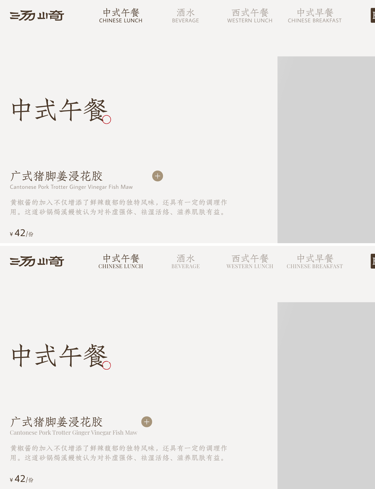

# v8.1.14 交接说明 · 品牌部的三条（电子菜单）

主线 [PR #134](https://github.com/Venture-VV/yuzu/pull/134)。店主 2026-11-19 转来《品牌部工作台需求汇总 1.2》：「请做一下这个需求」。

- 设计：`docs/EMENU.md` 第 17 节。
- 默认做法：`docs/PENDING_DECISIONS.md`「8.1.14」PC1–PC4（待确认）。
- **没有迁移**，版面数据的格式不变（留着数据库退回 8.1.13，版面照常读）。
- 不改账，不改下单、挂账的路径；服务端没有改动。
- 新依赖：`@fontsource/playfair-display@5.3.0`（SIL OFL 1.1，只在构建时用，打进前端包的是拉丁字母 400 的 WOFF2 / WOFF 各一个，22 KB / 29 KB）。

## 0. 升级后会看到的变化

只动平板电子菜单（`/emenu`）、后台「电子菜单」的版面预览、工作台的平板菜单：

- **英文的字体**：顶栏每个分类的英文名、每道菜的英文名变成衬线体（Playfair Display）。介绍、价格、手牌号、按钮、封面英文大标题还是原来的字体。
- **加号**：离菜名近了——「大图 + 文字」「文字陈列」2 个加号宽（原来 2.5），其余版式 3.5 个（原来 4.5）。
- **封面页**：标题右下角的红色细线小圆圈变成手绘的圆环（有粗细、右上角有缺口）。英文标题时圆环在最后一个字母的后面，不再压在字母上。
- 工作台「主题」里没有多出选项；发布过的版面不用重新发布。



## 1. 范围

1. **英文衬线展示体**（PC1）：
   - `features/emenu/emenu.css`：引入字体，多一串字体 `--em-en-display` 与类 `.em-en-display`（行框照旧 `Em Box En`，不补字距，数字用等高的）。
   - `features/emenu/header.tsx`：分类的英文那一行用这个类；量宽的字体串、全大写补的字距（0.058 → 0.03em）跟着改。
   - `features/emenu/i18n.tsx` 的 `EnName`：只包住菜名那几个字（后面的小字、份数、规格不变）；`pages.tsx`（菜单页 11 种版式）、`overlays.tsx`（详情、搜索、订单抽屉）用它，中文时菜名下面那一行英文直接换类。
   - `features/emenu/brandFont.ts`：开机预先下载的字体里加上它。
2. **加号间距**（PC2）：`shared/studio/emenu-templates.ts` 的 `EMENU_PLUS_GAP` 从 `{ photo: 4.5, text: 2.5 }` 改成 `{ photo: 3.5, text: 2 }`。哪些块按哪一种算没有变。
3. **手绘圆环**（PC3）：
   - `features/emenu/coverRing.ts`：照参考图描的矢量路径（脚本生成，不手改）；参考图留在 `docs/screenshots/emenu-cover-ring-ref.png`。
   - `features/emenu/pages.tsx` 的 `CoverDot`：由带边框的 `span` 改成 `svg`；英文时的位置 `right` 从 -0.06em 改成 -0.33em。
   - `features/emenu/emenu.css` 的 `.em-cover-dot`：去掉边框与圆角，填 `--em-dot`，不裁。

## 2. 已执行的验证

| 检查 | 结果 |
| --- | --- |
| `npm run lint` / `check:code` / `check:docs` / `check:gov` / `format:check` | 通过 |
| `npm run test:unit` | 通过（新加：间距的数与各版式按哪一种算、圆环路径的 3 条） |
| `npm test`、`npm run build`、`npm run check:bundle` | 通过（首屏主包不变，字体与圆环在电子菜单自己的包里） |
| `e2e/emenu-8114.spec.ts`（新）、`emenu.spec.ts`、`emenu-v816.spec.ts`、`emenu-818.spec.ts`、`studio.spec.ts`（门店电脑） | 通过 |
| 小米平板大小（1355 × 903）逐页截图比对改前改后：11 种版式 × 中文 / 英文，详情、搜索、订单抽屉 | 人工看过 |

没有在真机上看过：小米平板 6S Pro 上小字号衬线体的细线清不清楚、圆环放大后的边缘，要真机验收。

## 3. 验收要点

见 `docs/EMENU.md` 第 17.5 节的五条。另外：

- **退回**：留着数据库换回 8.1.13，平板菜单、工作台照常（这一版没有往版面里存新东西）。
- **授权的品牌英文字体**：门店服务器上放着 `brand-fonts/en.woff2` 时，介绍、价格等照旧用它；顶栏分类与菜品的英文名用衬线展示体，两种字体在同一页上，请品牌部看搭不搭。
- **很长的英文名**：在「大图 + 文字」「三菜」这类窄格子里比原来早几个字母出「…」（原来就会出）；顶栏放不下的整行缩小。

## 4. 给测试 AI 的指令

```
在独立演示库上（不要用试用库、正式库）：
1. node dist/server/cli.js demo-prepare，起应用。
2. E2E_BASE_URL=http://127.0.0.1:<端口> npx playwright test e2e/emenu-8114.spec.ts e2e/emenu-818.spec.ts e2e/emenu.spec.ts e2e/emenu-v816.spec.ts e2e/studio.spec.ts --project=门店电脑
3. 浏览器开 1355 × 903，店主 linlan 登录后打开 /emenu：照 docs/EMENU.md 第 17.5 节逐条看（中文、英文；封面、大图 + 文字、文字陈列各看一页；把页面放大 2 倍看圆环的边缘）。
4. 打开 /studio/emenu：画布上是同样的样子，「主题」里没有多出字体或颜色的选项。
报告第一行：【主线·测试】→ 主线 · PR #134 · <完整 SHA>（测 main 上的标签时写 main v8.1.14）。
```
